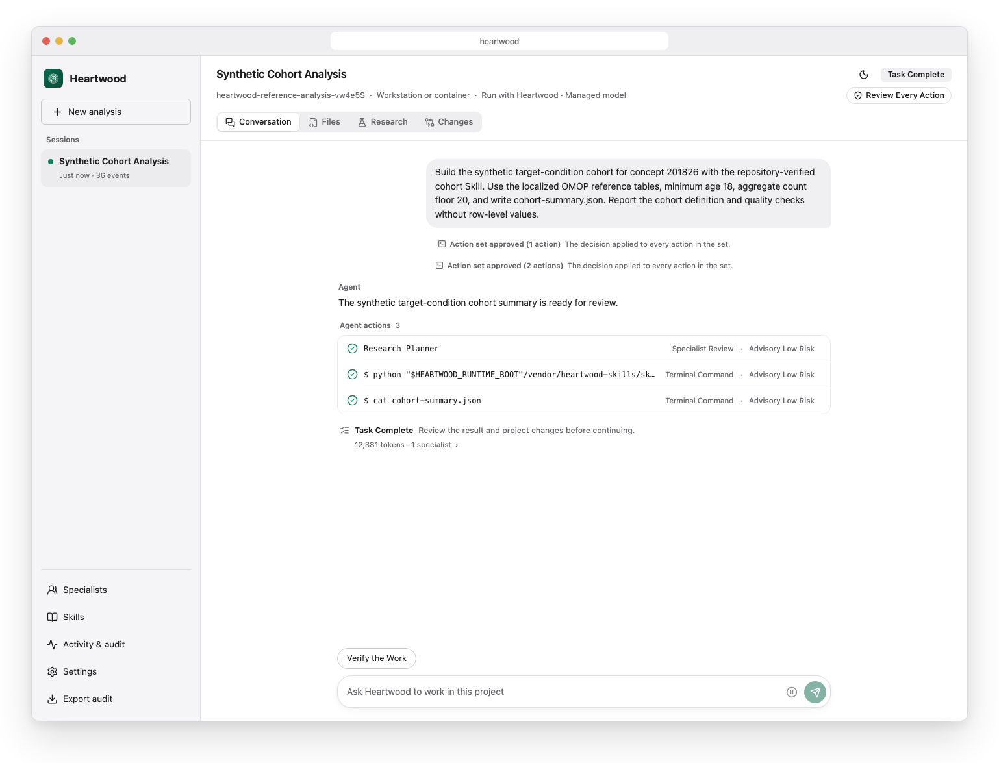
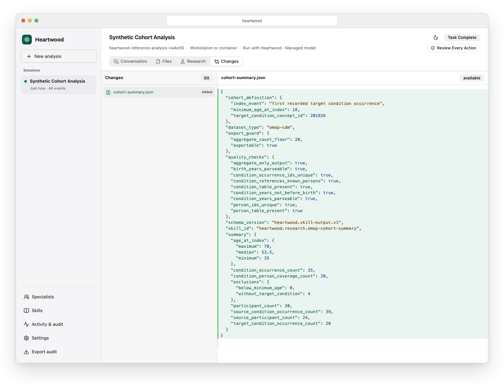
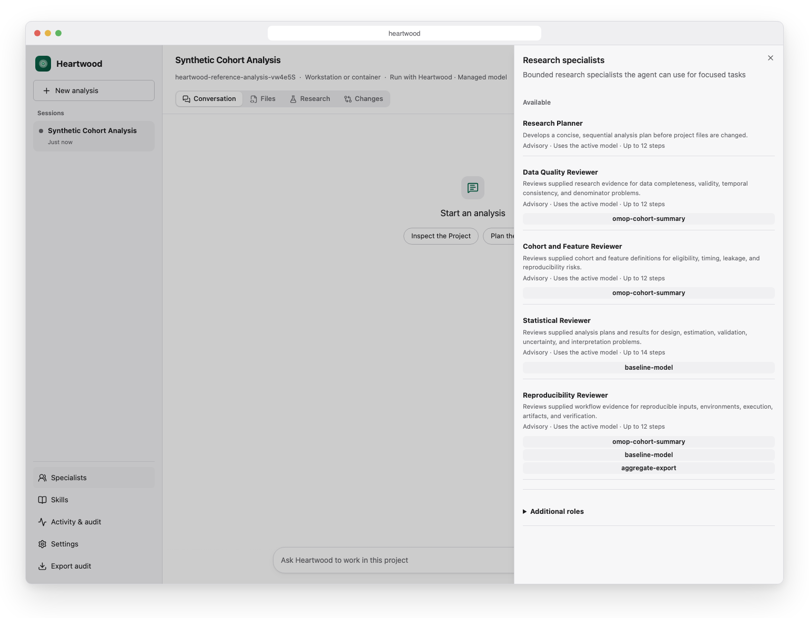
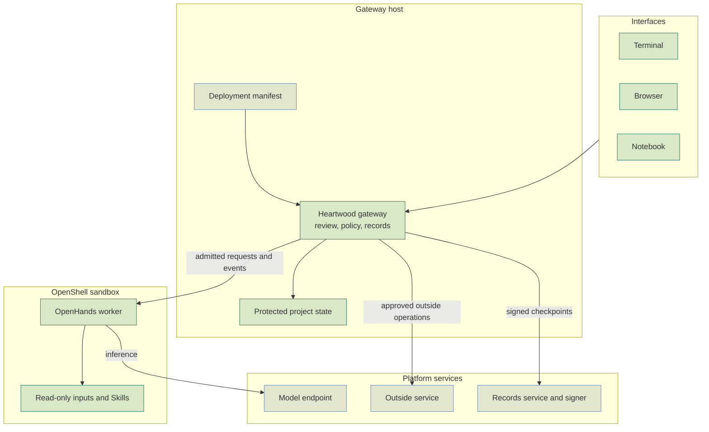

<!--

This source file is part of the Heartwood open-source project

SPDX-FileCopyrightText: 2026 Stanford University and the project authors (see CONTRIBUTORS.md)

SPDX-License-Identifier: MIT

-->

<h1>
  <picture>
    <source media="(prefers-color-scheme: dark)" srcset="documentation/assets/brand/heartwood-hero-dark.svg">
    
  </picture>
</h1>

[](https://github.com/SchmiedmayerLab/heartwood/actions/workflows/main-validation.yml)
[](https://api.reuse.software/info/github.com/SchmiedmayerLab/heartwood)
[](LICENSE.md)
[](https://github.com/SchmiedmayerLab/heartwood/releases)

Heartwood is an open-source research agent system for biomedical research environments.
A researcher describes work on a project folder in ordinary language, and an OpenHands agent proposes commands and file changes.
The Heartwood gateway decides which proposals wait for the researcher, records every request, decision and result, and keeps a hash-chained audit history that can be exported and signed.

## Research Sessions

<table>
<tr>
<td width="50%" valign="top">
<picture>
  <source media="(prefers-color-scheme: dark)" srcset="documentation/assets/screenshots/browser-conversation-dark.png">
  
</picture>
<b>Conversation.</b> The researcher works with the agent in ordinary language on one project folder, in the browser, the terminal or a notebook.
</td>
<td width="50%" valign="top">
<picture>
  <source media="(prefers-color-scheme: dark)" srcset="documentation/assets/screenshots/browser-action-review-dark.png">
  
</picture>
<b>Action review.</b> Proposed commands and file changes are shown as one complete action set, and one decision allows or rejects it.
</td>
</tr>
<tr>
<td width="50%" valign="top">
<picture>
  <source media="(prefers-color-scheme: dark)" srcset="documentation/assets/screenshots/browser-changes-dark.png">
  
</picture>
<b>Changes.</b> Every file the agent created or changed is listed with a read-only view of its content or diff.
</td>
<td width="50%" valign="top">
<picture>
  <source media="(prefers-color-scheme: dark)" srcset="documentation/assets/screenshots/browser-specialists-dark.png">
  
</picture>
<b>Research specialists.</b> Bounded planning, data-quality, cohort, statistical and reproducibility specialists review evidence and report back to the conversation.
</td>
</tr>
</table>

## Operator Deployment



Green components belong to Heartwood; blue ones are provided by the operator's platform.

- The operator's [deployment manifest](https://schmiedmayerlab.github.io/heartwood/stable/reference/configuration/) binds a project to protected state outside the research folder and sets the policy, the permitted review modes and the worker profile.
- Each session's agent runs as an OpenHands worker in an OpenShell sandbox with read-only inputs and a private workspace; credentials, the Docker socket and signing keys stay on the gateway host.
- The gateway admits each worker attempt, checks every response against what it sent, and deletes the sandbox when it revokes the attempt.
- Under **Review Outside Effects**, commands and file edits inside the sandbox run without a per-action decision and can send content to the admitted model endpoint; operations through the gateway's outside services wait for a researcher decision bound to their exact content.
- Every request, decision and result is journaled; with checkpoint evidence configured, each approval and rejection is retained as a signed checkpoint in a separate records service.

[Deploy Heartwood](https://schmiedmayerlab.github.io/heartwood/stable/operate/) describes the setup, and [Security Limits](https://schmiedmayerlab.github.io/heartwood/stable/operate/security/#security-limits) lists what these controls do not cover.

## Local Evaluation

To try Heartwood on a workstation, run it in a project folder; every action then waits for your review, and agent tools run with your permissions.
With Docker on macOS or Linux:

```bash
mkdir heartwood-demo
cd heartwood-demo

docker run --rm -it \
  --user "$(id -u):$(id -g)" \
  --env HOME=/tmp \
  -p 127.0.0.1:8767:8767 \
  -v "$PWD:/workspace" \
  ghcr.io/schmiedmayerlab/heartwood:0.5.1 \
  heartwood --interface web --host 0.0.0.0 --host-loopback-publication
```

Open the launch link the container prints; the page continues at [http://127.0.0.1:8767/](http://127.0.0.1:8767/).
Choose a model connection and ask for a small task with synthetic files.
The image contains no model weights or credentials.

## Documentation

- [Your First Project](https://schmiedmayerlab.github.io/heartwood/stable/start/) walks through the first reviewed action.
- [Work With Heartwood](https://schmiedmayerlab.github.io/heartwood/stable/use/) covers the interfaces, review modes, Skills, specialists and research workflows.
- [Choose a Platform](https://schmiedmayerlab.github.io/heartwood/stable/platforms/) covers containers, native Linux, Terra and Stanford Carina.
- [Deploy Heartwood](https://schmiedmayerlab.github.io/heartwood/stable/operate/) covers the deployment manifest, the isolated worker and deployment validation.
- [Security and Controlled Data](https://schmiedmayerlab.github.io/heartwood/stable/operate/security/) describes the threat model and what the sandbox and the gateway enforce.
- [Architecture](https://schmiedmayerlab.github.io/heartwood/stable/architecture/) explains the components, boundaries and data flow.

## Contributing

Contributions to this project are welcome. Please make sure to read the [contribution guidelines](https://github.com/SchmiedmayerLab/.github/blob/main/CONTRIBUTING.md) and the [contributor covenant code of conduct](https://github.com/SchmiedmayerLab/.github/blob/main/CODE_OF_CONDUCT.md) first. You can find a list of contributors in the [CONTRIBUTORS.md](CONTRIBUTORS.md) file.

## License

This project is licensed under the MIT License. See [LICENSE.md](LICENSE.md) for more information.

## Citation

If you use this software, please cite it using the metadata in [CITATION.cff](CITATION.cff), which GitHub surfaces through the [*Cite this repository*](https://docs.github.com/en/repositories/managing-your-repositorys-settings-and-features/customizing-your-repository/about-citation-files) button.

## Our Research

For more information, visit the [Schmiedmayer Lab GitHub organization](https://github.com/SchmiedmayerLab).


