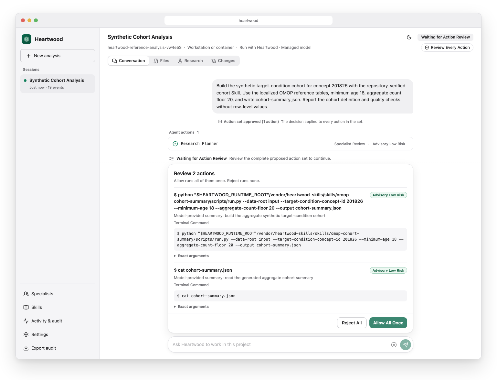

<!--

This source file is part of the Heartwood open-source project

SPDX-FileCopyrightText: 2026 Stanford University and the project authors (see CONTRIBUTORS.md)

SPDX-License-Identifier: MIT

-->

<h1>
  <picture>
    <source media="(prefers-color-scheme: dark)" srcset="documentation/assets/brand/heartwood-hero-dark.svg">
    
  </picture>
</h1>

[](https://github.com/SchmiedmayerLab/heartwood/actions/workflows/main-validation.yml)
[](https://api.reuse.software/info/github.com/SchmiedmayerLab/heartwood)
[](LICENSE.md)
[](https://github.com/SchmiedmayerLab/heartwood/releases)

[Stable Documentation](https://schmiedmayerlab.github.io/heartwood/) · [Prerelease Documentation](https://schmiedmayerlab.github.io/heartwood/preview/)

Heartwood is an open-source research agent system for biomedical research environments.
A researcher describes work on a project folder in ordinary language; an OpenHands agent proposes commands and file changes; a Heartwood gateway decides which proposals need the researcher, records every decision, and keeps a verifiable audit history.

The gateway owns project state, policy, action review, authorization of operations outside the agent, records and audit.
The terminal, browser and notebook interfaces are views over the same gateway contract.
An operator can run the agent as a complete worker inside an OpenShell sandbox, with protected state, credentials and approval authority kept outside it.

<picture>
  <source media="(prefers-color-scheme: dark)" srcset="documentation/assets/screenshots/browser-action-review-dark.png">
  
</picture>

## Who Runs What

- The researcher works in one project folder, chooses an authorized model where the deployment allows a choice, and allows or rejects what the agent proposes.
- The operator decides how Heartwood runs: the deployment manifest, protected state location, review-mode ceiling, isolated worker profile, credentials and checkpoint signer.
- The platform provides identity, storage, network controls, compute and inference, and keeps its own authority over them under the [platform contract](https://schmiedmayerlab.github.io/heartwood/operate/platform-contract/).

## Two Ways to Run It

### Local Launch

Run `heartwood` in a project folder on a workstation, in a container, on Terra or on Stanford Carina.
Heartwood keeps its state in `.heartwood/` inside that folder and reviews every action by default.
Agent tools run with your own permissions: an allowed command can read anything you can read and can change `.heartwood/`, including session and audit files.
Treat a local launch as a reviewed assistant, not as an isolation boundary.

### Operator-Bound Deployment

An operator starts `heartwood gateway serve --deployment /absolute/path/project.toml` with a manifest that binds the project to protected state outside the research folder.
With a `[worker]` section, each session runs in a sandboxed OpenShell worker on an operator-controlled Linux Docker host; the worker receives selected read-only inputs and verified Skills, and never the protected state, provider credentials, Docker socket or signing keys.
Operations outside the worker, and the release of their results back to it, are authorized only by a researcher decision bound to the exact content reviewed.
No production outside-service adapter ships and `gateway serve` installs none, so these operations are available only through an embedding launcher.

## What Is Qualified

- Container images, native installers and the Terra images are built and tested in CI for each release commit.
- The isolated worker passes native qualification in CI with synthetic workloads on Linux x86_64, producing evidence bound to the commit.
- Heartwood-managed model configurations are qualified per platform as listed in the [GPU compatibility matrix](https://schmiedmayerlab.github.io/heartwood/reference/gpu-compatibility/).

Not established:

- Sensitive-data readiness: no deployment of Heartwood is approved for protected health information or other controlled data.
- A production sandbox gateway: the patched OpenShell gateway that native qualification uses exists only in the qualification build, and a deployment's gateway is checked only by the version it reports.
- Institutional approval: synthetic qualification is evidence for review, not an approval.

## First Session

With Docker on macOS or Linux:

```bash
mkdir heartwood-demo
cd heartwood-demo

docker run --rm -it \
  --user "$(id -u):$(id -g)" \
  --env HOME=/tmp \
  -p 127.0.0.1:8767:8767 \
  -v "$PWD:/workspace" \
  ghcr.io/schmiedmayerlab/heartwood:0.5.0 \
  heartwood --interface web --host 0.0.0.0 --host-loopback-publication
```

Open the launch link the container prints; the page continues at [http://127.0.0.1:8767/](http://127.0.0.1:8767/).
Confirm the project, choose a model connection, and ask for a small task.
For the terminal, replace the last line with `heartwood`.
The image contains no model weights or credentials.

Use synthetic or non-sensitive files.
[Your First Project](https://schmiedmayerlab.github.io/heartwood/start/) walks through the first reviewed action, and [Choose a Platform](https://schmiedmayerlab.github.io/heartwood/platforms/) covers Terra, Carina and native Linux.
Operators start with [Deploy Heartwood](https://schmiedmayerlab.github.io/heartwood/operate/) and [Security and Controlled Data](https://schmiedmayerlab.github.io/heartwood/operate/security/).

## Contributing

Contributions to this project are welcome. Please make sure to read the [contribution guidelines](https://github.com/SchmiedmayerLab/.github/blob/main/CONTRIBUTING.md) and the [contributor covenant code of conduct](https://github.com/SchmiedmayerLab/.github/blob/main/CODE_OF_CONDUCT.md) first. You can find a list of contributors in the [CONTRIBUTORS.md](CONTRIBUTORS.md) file.

## License

This project is licensed under the MIT License. See [LICENSE.md](LICENSE.md) for more information.

## Citation

If you use this software, please cite it using the metadata in [CITATION.cff](CITATION.cff), which GitHub surfaces through the [*Cite this repository*](https://docs.github.com/en/repositories/managing-your-repositorys-settings-and-features/customizing-your-repository/about-citation-files) button.

## Our Research

For more information, visit the [Schmiedmayer Lab GitHub organization](https://github.com/SchmiedmayerLab).


