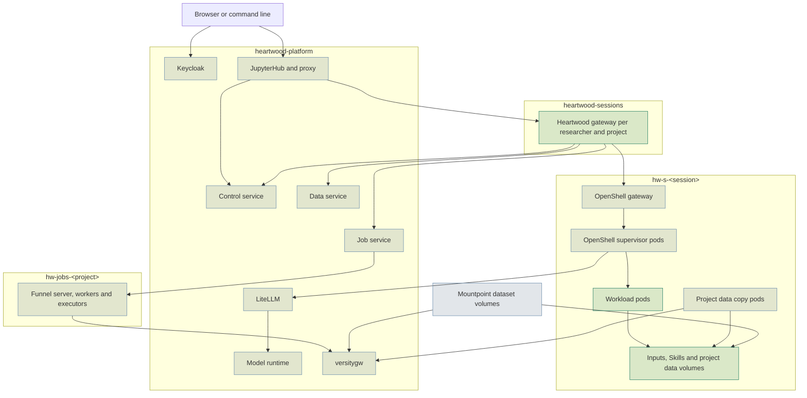

<!--
This source file is part of the Heartwood open-source project
SPDX-FileCopyrightText: 2026 Stanford University and the project authors (see CONTRIBUTORS.md)
SPDX-License-Identifier: MIT
-->

# Reference Platform

The Kubernetes reference platform implements the platform side of the [Platform Contract](../operate/platform-contract.md) for synthetic and open data.
One Helm chart installs it, with values for a local kind cluster and for the GKE cluster that `reference-platform/infrastructure/gke` defines; only cluster-specific values differ.
It starts one Heartwood gateway for each researcher and project, runs each worker through the OpenShell Kubernetes driver, serves project data, runs batch jobs, routes inference, and keeps estimates, allocations and spending.
Platform identity, project access, billing attribution and spending enforcement stay in the platform; Heartwood reads them and links them to its own approval records.
Independent platforms implement the same contract without this code.

This page records the architecture and the reasons for its main choices.
`reference-platform/README.md` describes the chart values, services, policies and procedures in detail, and [Platform API and Access Requirements](../operate/platform-requirements.md#kubernetes-worker-path) lists what any cluster must provide for the Kubernetes worker path.

Green marks what Heartwood supplies, the gateway, the worker and its read-only projections, and blue marks platform and upstream components, as in [System Architecture](system.md).

## Components and Ownership

Heartwood application packages own the gateway and the worker.
Code under `reference-platform/` owns the platform services, the chart, the Hub configuration and the cluster scripts.
Upstream components are deployed unchanged or with recorded patches, and the operator owns the cluster, its network plugin and its nodes.

| Component | Owner | Namespace | Role |
|---|---|---|---|
| Heartwood gateway, `hosted-gateway-image` stage of `images/Dockerfile` | Heartwood | `heartwood-sessions` | Verifies the researcher, owns the session, launches, admits and revokes workers, and authorizes outside operations |
| Heartwood worker image | Heartwood | Session namespace | OpenHands agent server in the workload pod |
| Kubernetes worker adapter, `worker_kubernetes.py` | Heartwood | In the gateway | Stages inputs, reads pods for admission and checks absence after revocation, through `kubectl` |
| Control service | Reference platform | `heartwood-platform` | Project registry, launch and session provisioning, price sheet, estimates, allocations and reservations, in one process with one SQLite database |
| Data service | Reference platform | `heartwood-platform` | Catalog over MCP, DRS 1.5 read endpoints and presigned object access |
| Job service | Reference platform | `heartwood-platform` | MCP tools for batch tasks, in front of each project's TES executor |
| Keycloak | Upstream | `heartwood-platform` | Identity provider and standard token exchange |
| PostgreSQL | Upstream | `heartwood-platform` | Database of Keycloak and LiteLLM |
| JupyterHub, its proxy and idle culler | Upstream, with Hub configuration from the reference platform | `heartwood-platform`, spawning into `heartwood-sessions` | Sign-in, one named server per researcher and project, routing and culling |
| LiteLLM | Upstream | `heartwood-platform` | Model route with one virtual key per session |
| Synthetic model | Reference platform | `heartwood-platform` | Deterministic test model behind LiteLLM |
| `llama-server` or a hosted model | Upstream, operator choice | `heartwood-platform` or outside the cluster | Models behind LiteLLM |
| versitygw | Upstream | `heartwood-platform` | S3-compatible store with one bucket per project |
| Funnel | Upstream with recorded patches | `hw-jobs-<project>` | TES executor, one server per project |
| OpenShell gateway with the Kubernetes driver | Upstream with recorded patches | Session namespace | Sandbox lifecycle for one researcher and project |
| Agent Sandbox controller | Upstream | `agent-sandbox-system` | Creates workload pods from Sandbox resources |
| Mountpoint S3 CSI driver | Upstream, installed by the operator | `mount-s3` | Read-only volumes of granted dataset versions |
| Network plugin, nodes, storage classes | Operator | Cluster | NetworkPolicy enforcement, process limits, cgroup v2 and storage; Calico on kind, Dataplane V2 on GKE |

The registry, launch and budgets share one control service, so the billing binding, the allocations and the reservations live in one database, and one service holds the Keycloak client administration and the LiteLLM master key.
The platform services are Python in their own uv project, `reference-platform/services`, which no application package can depend on.
The cloud boundary check, `reference-platform/tools/check_cloud_boundary.py`, keeps cloud SDKs and cloud identifiers out of the application packages, and the GKE cluster is defined only in `reference-platform/infrastructure/gke`.

## Trust Boundaries

| Zone | Components | Trusted for |
|---|---|---|
| Researcher device | Browser or command line client | One researcher |
| Platform control | Keycloak, the Hub and proxy, the control, data and job services, LiteLLM, Funnel servers, versitygw | The whole platform, operated by the platform operator |
| Session | One Heartwood gateway and its OpenShell gateway and supervisors | One researcher and one project |
| Worker | Workload pod with the agent server, its tools and its model client | Nothing |

The workload pod is untrusted, as in the Docker reference adapter.
It holds no Kubernetes token, no store credential and no model key; the model key reaches the model route only through the OpenShell supervisor, which resolves a placeholder.
The Heartwood gateway and the OpenShell gateway of a session act for one researcher and project, and no gateway reaches another except through the proxy, where each gateway verifies its own researcher.
The Hub is a trusted platform component: it can start any session's gateway with that session's ServiceAccount and Secret, but it has no access to Secrets.
Platform services take no claim of Heartwood as authority: they verify each token and check the registry on every call, and a launch context that Heartwood presents never sets the billing binding.

## Namespaces and Network Policies

| Namespace | Created by | Contents |
|---|---|---|
| `heartwood-platform` | Chart | Keycloak, PostgreSQL, the platform services, the Hub and proxy, LiteLLM, the model runtime and versitygw |
| `heartwood-sessions` | Chart | One gateway pod and one volume claim per researcher and project |
| `hw-s-<session>` | Control service, at the first launch | The session's OpenShell gateway, its sandboxes, staging and copy pods, and the attempt and project data claims |
| `hw-jobs-<project>` | Chart, with the Funnel executor | One project's Funnel server, worker Jobs and executor Jobs |
| `agent-sandbox-system` | Cluster setup; `reference-platform/cluster/create-cluster.sh` on kind | Agent Sandbox controller |
| `mount-s3` | Operator, with the Mountpoint S3 CSI driver | Mountpoint pods of dataset volumes |

Every namespace that the chart or the control service creates denies ingress by default, and each component admits only its named callers; `agent-sandbox-system` and `mount-s3` carry no such policy from the platform.
Session and jobs namespaces also deny egress by default and enforce the restricted Pod Security level.
The driver's own policy allows supervisor pods all egress ([Kubernetes Worker Path](../operate/platform-requirements.md#kubernetes-worker-path)), and a NetworkPolicy can only add allowances, so the ingress denial of the platform's namespaces is what keeps supervisors away from platform services other than those that admit them, such as LiteLLM.
Supervisors can still reach the API server, namespaces without ingress denial, and outside addresses.
In a session namespace, the OpenShell gateway accepts its supervisors, the session's own Heartwood gateway and the control service, and reaches only DNS and the API server.
Staging pods have no network, and copy pods reach only DNS and versitygw.
Funnel workers reach their server, the object store, DNS and the API server, and executor pods of a batch task reach nothing.
`reference-platform/README.md` lists each policy.

## Kubernetes Permissions

Kubernetes RBAC cannot name namespaces that are created at run time, so the platform combines three mechanisms:

- The chart ships fixed ClusterRoles for every role in a session namespace.
- RoleBindings are the only RBAC objects created per session; no principal creates Roles or holds `escalate`.
- ValidatingAdmissionPolicies with failure policy `Fail` confine what each principal may create, bind or exec into.

| Principal | Rights | Confinement |
|---|---|---|
| Control service | Creates and deletes session namespaces; binds five fixed ClusterRoles there, `heartwood-session-control`, `heartwood-openshell-sandbox`, `heartwood-openshell-peer`, `heartwood-openshell-certgen` and `heartwood-session-gateway`; sets the subjects of the ClusterRoleBinding `heartwood-openshell-node-reader`; creates the gateway ServiceAccounts and Secrets and the read-only dataset volumes of granted versions | `heartwood-control-scope` limits the names, labels, role and subject pairs and the volume shape. The control service remains the most privileged platform principal and reads every session's pods |
| Heartwood gateway `hw-gw-<session>` | `heartwood-session-gateway` in its own session namespace: pods and claims, exec, and reads of NetworkPolicies, Sandbox resources and the namespace | `heartwood-staging-shape` and `heartwood-staging-names` allow only staging pods, attempt claims and exec into staging pods |
| OpenShell gateway `openshell` | The upstream sandbox and peer rules in its own namespace, and the cluster-wide node reads and token reviews of the driver | Namespace boundary |
| OpenShell certificate Job `openshell-certgen` | Secrets `get` and `create` in its own namespace, for the session's PKI | Namespace boundary |
| Hub | Role `heartwood-hub-spawner` in `heartwood-sessions`, without Secrets or Services | `heartwood-hub-pods` fixes the shape of every gateway pod and claim it creates |
| Funnel server and workers | Roles in their project's jobs namespace | `heartwood-funnel-worker-jobs` binds each worker's Jobs to its own task, claim and executor shape |

No principal holds `pods/ephemeralcontainers`, `pods/attach` or `pods/portforward` in a session namespace, for the reasons in [Kubernetes Worker Path](../operate/platform-requirements.md#kubernetes-worker-path).
Researchers receive no Kubernetes API access.

## Credential Handling

- Kubernetes principals authenticate with projected ServiceAccount tokens that the kubelet rotates; platform services verify each other's tokens with a TokenReview and a per-service audience, so internal calls need no client secrets.
- Researcher tokens and exchanged service tokens live in the Heartwood gateway's memory only and never enter project files, agent tools, model context, events or exports.
  After a restart or cull the researcher signs in again.
- Platform services never forward a researcher's token; they call each other with their own tokens and pass the researcher and project as data.
- Each project has one confidential Keycloak client, `hw-proj-<project>`, whose secret the control service writes into the Secret of each member's session; only the gateway pod's init container mounts that Secret.
- The control service holds the Keycloak role `manage-clients` and the LiteLLM master key, and no component keeps a standing Keycloak administrator.
- Each session has its own LiteLLM worker key, held in the OpenShell provider store of its session and encrypted with a per-session key-encryption key; the control service keeps only its hash.
- The data service and the job service hold their own object store accounts; copy pods and Funnel workers receive only presigned URLs for single objects, executor pods receive no URL and no network, and the Mountpoint driver holds the dataset reader account outside the worker pod.
- Helm generates the chart's credentials and the platform CA at the first installation and keeps them on upgrades; the platform CA signs the serving certificates of the platform's HTTPS services.
- The control service creates each session's key-encryption key and model keys, and an issuing CA, created again at each start of the control service, from which it signs each gateway's certificate.
- Keycloak generates the project client secrets, and the OpenShell certificate Job creates each session's OpenShell PKI.

## Main Flows

### Sign-In and Launch

1. The researcher signs in to the Hub through Keycloak; the Hub's user name is a keyed researcher identifier, so the subject appears in no URL or access log.
2. The spawn form offers one named server per project of the researcher, from the control service's project list.
3. Before each start the Hub asks the control service to prepare the session and refuses the start on any error.
4. The control service checks membership, reserves the session's inference budget, brings `hw-s-<session>` with its quota, policies, RoleBindings and OpenShell objects to the same state, creates the gateway ServiceAccount, creates the session's model key and provider, registers the gateway's callback with the project client, prepares the project data, and writes the gateway's deployment manifest, launch context and credentials into the Secret `hw-gw-<session>`.
5. The Hub starts the gateway pod with that ServiceAccount; an init container copies the Secret into an owner-only memory volume and records the effective worker policy digest from the session's OpenShell gateway.
6. The researcher opens the server on its own HTTPS host, one per researcher and project, and the gateway signs the researcher in with the authorization code flow as `hw-proj-<project>` and accepts only the subject that its manifest binds.

Idle culling stops the gateway pod and keeps the volume claim, the session namespace and the OpenShell gateway, so the next start continues the same session.
Deleting the named server deletes the session, settles its inference reservation and removes its namespace.

### Token Exchange

For platform calls the gateway requests a standard token exchange (RFC 8693) with the scope `svc-<service>` and the audience `heartwood-<service>`, for the control, data and job services, and keeps each exchanged token in memory per scope and audience until shortly before it expires.
The exchanged token keeps the researcher's subject, carries the project client as authorized party `azp`, and has one audience.
The service verifies signature, issuer, expiry and audience, takes the project from `azp`, and checks membership in the registry.
Keycloak refuses the exchange to another project's client and refuses an audience without its scope.

### Worker Launch and Admission

The gateway launches each worker attempt through the session's OpenShell gateway, with its client certificate:

1. It stages the attempt's inputs and Skills into two attempt claims through a staging pod without network: it streams a tar archive through `kubectl exec` into `tar` in the pod, compares the digest of the staged tree with the archive, then removes the pod.
2. It creates the sandbox with read-only mounts of `/inputs`, `/skills` and the project data path, and a sandbox policy that keeps them read-only.
3. It reads the workload pod, the supervisor pod, the NetworkPolicies and the namespace through the API and admits the worker only when they match the [accepted values](system.md#kubernetes-worker-admission).
4. At revocation it deletes the sandbox through OpenShell and records it as revoked only after neither its pods nor its Sandbox resource exist.

The attempt's infrastructure identity is a SHA-256 digest over the API server address, its CA, the namespace name and UID, and the workspace, so a recreated namespace or another cluster yields another identity.
[Kubernetes Worker Staging](system.md#kubernetes-worker-staging) and [Kubernetes Driver Qualification](testing.md#kubernetes-driver-qualification) describe the adapter and its evidence.

### Project Data

The data service lists each project's datasets with DRS identifiers, sizes and SHA-256 checksums; the bytes live in the project's versitygw bucket.
A project has one of two data paths for interactive sessions:

- **Copied data.** At launch the control service asks the data service for presigned URLs, runs a copy Job in the session namespace that verifies each checksum, and labels the filled claim so the driver attaches it to the session's sandboxes; failed copies are retried with new URLs.
- **Mounted dataset version.** An operator grants one verified version of one dataset to a project, named by the digest of its content manifest.
  The control service creates a read-only Mountpoint volume of that version's prefix for the session's claim `hw-mounted-data`, the bucket policy seals the version against writes and deletes, and the worker holds no store credential and no route to the store.

Either way the worker reads project data read-only at `/data`, the manifest declares the claim, and admission checks its mount and project.
The researcher and the agent find datasets through the data service's read-only MCP catalog.
Batch tasks receive their declared inputs staged by the executor.

### Jobs

1. The worker proposes a task; the gateway's [outside operation](../operate/platform-contract.md#outside-operation-admission) path builds a proposal through `propose_task` with resources, run time, estimate, data scope and results location.
2. After the researcher approves it, the gateway calls `create_task` with an exchanged `heartwood-jobs` token and the operation identifier.
3. The job service checks membership and entitlements, records the submission, reserves the full compute price of the run time limit, and submits the task to the project's Funnel server with presigned input and output URLs.
4. Status maps TES states to contract states, cancellation reports what it observed, and settlement charges the observed run time and releases the rest of the reservation.

A repeated operation identifier with the same arguments returns the existing task, and the service cancels tasks that no operation recorded.
The [platform job operations](../operate/platform-contract.md#platform-job-operations) define the contract.

### Inference

The worker calls its model through the OpenShell supervisor, which replaces a placeholder with the session's LiteLLM key and sends the request to LiteLLM.
The key lists the route's models and only the routes `/v1/chat/completions` and `/v1/models`, has a budget, and allows one request at a time.
LiteLLM verifies in-cluster model runtimes against the platform CA and sends each runtime its API key, which the synthetic model and `llama-server` require.
The gateway lists models with a separate discovery key that may only list them.

### Estimates and Budgets

The chart value `syntheticPrices` provides one price sheet, in the FOCUS SKU Price terms that the [platform contract](../operate/platform-contract.md#launch-context-budgets-and-estimates) pins, to both the control service and LiteLLM's per-model costs.
The control service's `estimate_workload` tool prices plans and their elements across exploration, batch and GPU jobs and inference, with coverage and validity, and reports unpriced work as unknown.
Each project has an `inference` and a `compute` budget; reservations and spending live in the control service's database, and every reservation is one transaction that checks availability, so concurrent sessions and jobs cannot exceed an allocation.
A session reserves the configured inference amount at its first launch, or what is available when less is left, its key's budget stays below the reservation by one request's largest cost, and deletion settles the spending that LiteLLM recorded.
Heartwood reads budgets with `get_budgets` and links them to its approval records, as [Planning Against Platform Budgets](../operate/platform-contract.md#planning-against-platform-budgets) describes; it keeps no ledger and enforces no budget.

## Design Decisions

| Point | Decision | Reason |
|---|---|---|
| Sandbox gateway | One OpenShell gateway per researcher and project, in its own namespace | Every client of one OpenShell gateway has the same identity there, so a shared gateway would let one researcher's gateway manage another's sandboxes |
| Driver mode | Shared workspace mode with the release and sandbox namespace equal | Each session's objects, policies and quota stay in one namespace under the restricted Pod Security level |
| Session namespaces | Created by the control service at the first launch and deleted with the named server | The spawn hook is where the researcher and the project are both known and authorized, and the Hub keeps namespace-scoped rights |
| Hub placement | Hub and proxy in `heartwood-platform`, spawning through a platform-owned Role without Secret access and an admission policy on its pods | The Role of the upstream chart grants every Secret of the spawn namespace |
| Project binding | The project comes from `azp`; no project claim mapper | The project client performs the exchange, so `azp` already names the project, and Keycloak refuses the exchange to another project's client |
| Service audiences | Realm-level optional scopes `svc-control`, `svc-data` and `svc-jobs`, attached to each project client | Attaching an existing scope works with `manage-clients`, and each exchanged token carries one audience |
| Internal authentication | Projected ServiceAccount tokens with one audience per service, verified by TokenReview | No client secret for internal calls |
| Browser origins | One HTTPS host per researcher and project, under a dedicated DNS zone | Cookies and browser storage of one project's gateway are out of reach of another's |
| Researcher names | A keyed identifier of issuer and subject in Hub user names, paths and redirect URIs | Subjects stay out of URLs and access logs |
| Object store | versitygw in the cluster on kind and on GKE | One chart path and no cloud storage API or cloud identity in platform services |
| Large datasets | Read-only Mountpoint volumes of granted, sealed versions; copy at launch for small data | Large data is not copied per session, the reader credential stays outside the worker pod, and a session reads one immutable version |
| Job executor | Funnel, one server per project in its own namespace, behind the job service's `TesExecutor` interface | An existing GA4GH TES implementation, with per-project credentials, quota and policies; recorded patches add TLS, per-task worker credentials and the GPU count |
| Inference budgets | LiteLLM virtual keys with per-key budgets, model lists and route lists, one key per session | These key features are in LiteLLM's open-source edition; LiteLLM never sees a researcher token, and the platform ledger stays in the control service |
| Budget and estimation backends | A synthetic price sheet from the chart value `syntheticPrices` and a ledger of allocations, reservations and spending in the control service's SQLite database | The platform's prices and allocations are synthetic; one price sheet prices both estimates and LiteLLM's per-request costs, and each reservation checks availability in one transaction beside the registry that holds the billing binding, without an external pricing or billing service |
| Databases | SQLite on a volume for each platform service, one replica; PostgreSQL only for Keycloak and LiteLLM | Reservations are single transactions without a further database service |
| Certificates | A platform CA that Helm generates, with a name-constrained issuing CA for gateway certificates | TLS between the services, the proxy and the gateways without a certificate controller; PostgreSQL connections stay inside its network policy |
| Network policy | A network plugin that enforces NetworkPolicy; Calico on kind, Dataplane V2 on GKE | Worker confinement depends on enforced policies |
| Images | Pinned by digest in the chart values; the values schema refuses a reference without one | The cluster runs exactly the qualified images, as [Published Images](../operate/platform-requirements.md#published-images) describes |

## Related Pages

- [Platform Contract](../operate/platform-contract.md) defines the interfaces that this platform implements.
- [System Architecture](system.md) describes the gateway, the worker and the Kubernetes worker admission.
- [Security and Controlled Data](../operate/security.md) describes the threat model, researcher identity and service tokens.
- [Testing and Evidence](testing.md) describes the Kubernetes driver qualification and the evidence levels.
