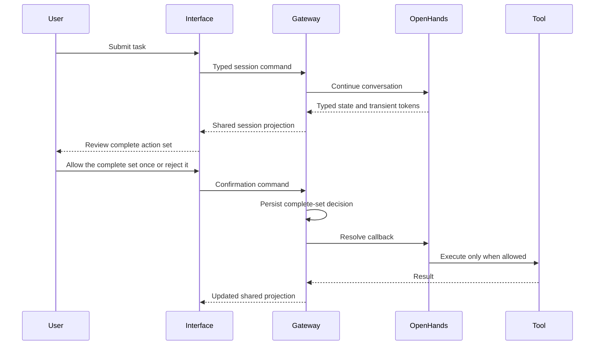

<!--
This source file is part of the Heartwood open-source project
SPDX-FileCopyrightText: 2026 Stanford University and the project authors (see CONTRIBUTORS.md)
SPDX-License-Identifier: MIT
-->

# Sessions and Audit

Heartwood separates presentation state from durable session evidence.
The gateway reduces one ordered event stream into the authoritative session projection used by terminal, browser, and notebook clients.

## Command Flow

## Persistence

Session directories contain metadata, event records, audit records, exports, and OpenHands persistence for that conversation.
Session identifiers are validated before any state path is created.
The gateway incrementally translates persisted OpenHands messages, actions, observations, lifecycle, task, usage, specialist, and error state into Heartwood events.
While a native run is executing or publishing its final events, its live publisher owns event delivery.
Read-side reconciliation waits for that publisher to finish so it cannot consume an observation before live reproduction evidence is recorded.
After the publisher exits, reconciliation can recover persisted events without claiming that replay observed their execution.
Incremental token deltas remain in process memory and disappear after the run reaches a stable boundary or the process stops.
Each REST, WebSocket, and server-sent-events response pairs an event batch with the projection produced from the same serialized snapshot.
A transient revision orders token-only updates that share a durable event revision.

Read-only replay returns no events for a new session without initializing the project.
The first mutating command registers the session and creates private state.

The gateway acquires an interprocess writer lease before mutating a session and retains it until that gateway closes the session service.
If an OpenHands worker does not stop during shutdown, Heartwood keeps the lease instead of allowing another writer to mutate the session.
After shutdown succeeds, the closed session service rejects further commands and reconciliation and discards later backend event callbacks before acquiring a writer lease.
Final events delivered during shutdown remain durable; this lifecycle fence does not establish remote worker identity or terminate an independently running worker.
A second process cannot reconcile or mutate that session until the owner releases the lease or exits.
Replay and live updates remain available through the interface connected to the owning gateway.
Distinct sessions have independent leases.
Trusted worker launch uses `SessionService.launch_worker` to retain an attempt before invoking the platform launcher and bind the observed runtime only after that call succeeds.
The launcher must use the retained identity with the native sandbox lifecycle and verify the authorized image, effective policy, active configuration, and process generation before returning a binding.
Missing generation, failed admission, interruption, or an uncertain create response leaves the attempt fenced for outside reconciliation; Heartwood does not retry creation or infer that no worker exists.
`revoke_worker` closes local admission before invoking the platform's revocation observer and records only returned evidence matching the retained attempt and runtime.
A failed or uncertain revocation does not permit replacement.
Launch, revocation, and service shutdown are serialized independently of command and event handling, so shutdown cannot release writer ownership while a launch may still return.
Platform callbacks must bound their control-plane operations and must not wait for session shutdown or recursively start another worker lifecycle operation.
These coordination methods do not install a platform launcher, terminate workers themselves, or infer infrastructure enforcement from a worker acknowledgement.
Writer admission and session-catalog changes briefly hold one admission lock for the session root.
An internal maintenance context holds that gate while acquiring every existing session writer lock; an active writer prevents maintenance from starting.
The context leaves writer metadata and historical records unchanged and releases its locks after failure or process exit.
Gateway versions that do not use the admission lock must be stopped before maintenance.
This excludes session writes only; project configuration, runtime activity, and model transfers require separate exclusion before a complete state migration.
Internal migration staging first excludes gateway startup and acquires every registered gateway lifetime lease; any active gateway prevents staging.
The native inference supervisor shares this ownership protocol, and an unresolved inference launch intent also prevents staging after a launcher crash.
It then verifies paired session and audit histories and command receipts under the configuration and session locks and copies their original bytes into a private directory on the destination volume.
The copy is verified again before a receipt records its file hashes and session heads.
Pending append recovery, unresolved commands, corrupt records, symbolic links, and existing destinations prevent staging.
Worker recovery state, writer metadata, and derived exports remain in the source; they are not promoted into canonical records.
The staged copy is temporary and cannot be opened as a project; leaving the staging context removes it and leaves the original records in place.
An abrupt process exit can leave an inert staging directory; a retry uses a fresh directory and never adopts an earlier partial copy.
Staging neither switches a deployment binding nor authenticates historical records, and is not exposed as an operator migration command.
Mutation acquires the writer lease before the paired-snapshot lock; recovery and replay never hold the snapshot lock while waiting for a writer lease.
This fixed ordering prevents deadlock as new gateway workers and presentation adapters reuse the store.

Session state must reside on storage that implements process-shared native advisory locks.
Heartwood disables existence-lock fallback because it cannot provide the same automatic release after process termination.
Local disks, attached persistent disks, and qualified project filesystems are the intended locations; object-store and file-transfer mounts are not session stores unless their native-lock behavior has been qualified.

Every command has an opaque identifier and a durable receipt.
An exact retry of a completed command returns its original event range without repeating a model call, confirmation callback, or tool action.
Reusing the identifier with different command content is rejected.
If a process stops after command acceptance but before completion is recorded, Heartwood refuses to execute that identifier again unless its exact outcome can be derived from durable state.
An interrupted approval is completed automatically only when its recorded intent and OpenHands state unambiguously prove whether the complete action set was resolved.
Outside decisions distinguish authorization from attempted dispatch.
An authorized record proves that the native call has not started; a submitting record means its outcome may be uncertain.
A configured required-evidence gate must observe the authorization checkpoint before recording submission and calling the adapter.
An interrupted authorization can resume only with the original decision, a live matching worker and renewed input, policy and expiry checks.
Read-only reconciliation skips undispatched authorizations; it never converts observation into submission authority.
Otherwise, the session rejects further mutation so a second approval or task cannot repeat an uncertain side effect.
After replaying and verifying the available evidence, continue in a new session.

Each session event and its corresponding audit record are committed through a private recovery journal.
After an interrupted append, the next writer verifies the journal, hash links, and existing records before completing only the missing write.
Malformed or inconsistent recovery state fails closed.
After process loss, a persisted OpenHands `RUNNING` state is reported as an unknown outcome and cannot be resumed or repeated automatically.

## Persisted Schema Compatibility

Every current independently persisted Heartwood envelope declares a schema version.
Supported legacy inputs are migrated before typed validation.
The project state marker records the current versions for project configuration, session events and metadata, command receipts, commit recovery, writer ownership, audit events, Skill metadata, and OpenHands state.
A shared migration registry provides one deterministic, forward-only path for each supported older version without mutating its input.

Project-state migration runs under the initialization lock and replaces metadata atomically.
Domain loaders apply the same registry before typed validation, so migration routing cannot bypass the record owner.
Unknown versions, migration cycles, nondeterministic transforms, malformed records, and unsupported fields fail closed without including persisted content in error messages.

OpenHands persistence records the exact SDK version and Heartwood content-minimization policy that wrote the state.
Heartwood validates that marker before reading or rewriting conversation events.
An SDK change therefore requires an explicit, tested migration instead of silently adopting possibly incompatible state.
When no migration is supported, Heartwood leaves the saved OpenHands records unchanged and reports `HW-AGENT-013`.
The session history remains available for inspection; new work can start in a new session in the same project.
SDK profile and provider-connection storage is scoped to private conversation state rather than a global OpenHands installation.

## Action Decisions

OpenHands can supply several proposed tool calls through one confirmation callback.
Heartwood displays every member as one action set and applies one decision to the complete set; it does not imply that members can be approved independently.
The complete proposal and confirmation request must already be durable before the gateway accepts a decision.
If native pending state arrives ahead of its live publisher, a decision is rejected without resolving the callback; a fresh command can be submitted after publication.
The gateway commits that complete-set decision before OpenHands can continue into model or tool execution.
The pending set is reconstructed from unmatched OpenHands actions after restart rather than from a separate Heartwood cache.
Its identifier contains a full SHA-256 digest of the ordered tool-call identifiers, native action identifiers, tool names, action kinds, and exact structured arguments.
Canonical JSON makes object-key order irrelevant while preserving list and action order.
Changed arguments, substituted tools, or added actions require a different decision even when tool-call identifiers are reused.
Advisory risk labels and presentation summaries are not execution authority and do not change this binding.
The gateway and backend both compare the current binding before resolving a decision.
This binds the proposed action content; it does not freeze files referenced by a command or establish an outside security boundary for local tool execution.
An approval identifier without the complete action-content binding is invalid; preserved history does not authorize new execution.

Each OpenHands proposal becomes one `heartwood.action-record.v1` projection correlated by stable action and tool-call identifiers.
The same record accumulates its group, decision, execution state, bounded result, and typed affected-path evidence across replay.
Terminal, file-editor, Task, and other actions use typed variants, while the exact OpenHands arguments remain available for review.
Unknown outcomes fail closed and are never converted into a successful result by an interface.

## Audit Integrity

Audit records are chained so replay and export detect corruption, and any modification, reordering, or removal made without recomputing the chain.
The chain uses no key, so a process that can write canonical state can rewrite records and recompute it.
In local mode, an approved same-identity agent command can reach `.heartwood/`; managed workers must be denied access to external state by the surrounding sandbox.
The trusted gateway can still write its state, so external placement does not replace independently retained checkpoints.
Only a signed checkpoint binds the history, and only as it stood when the checkpoint was signed.
Each content-minimized audit record also authenticates the corresponding complete session event by hash; replay requires matching counts, sequence, type, time, chain link, and event hash.
The recovery journal repairs a verified interrupted two-file append before replay, while tampered or unexplained mismatches fail closed.
Standalone JSON Lines appenders serialize writers with a native lock and use a durable journal to recover an absent, partial, or completely written final record without duplication.
Normal append validates the chain head needed for the next record; replay, verification, export, and checkpoint operations verify the complete available history.
The export path is itself recorded as an event.

A deployment can create a canonical checkpoint outside the project through the provider-neutral `CheckpointSigner` contract.
The signed payload binds the audit digest, event count, terminal hash, session, deployment identifier, creation time, retention declaration, signer identity, key identity, key version, algorithm, and public-key fingerprint.
Managed deployments resolve an approved HTTPS signer and independently trusted public key from one deployment-owned registry; project state stores only the selected profile identifier.
The explicit development and offline fallback uses the same contract through an authenticated Unix socket in an owner-only directory, with an owner-only Ed25519 key.
Verification requires the active deployment profile or a public key obtained through an independent trust path and rejects noncanonical or unexpected bundle content.
The chain and signature cannot prove that an intact suffix was not deleted before checkpoint creation.
An operator-bound evidence controller additionally verifies the complete independently retained checkpoint history and requires each successor to extend the retained audit prefix.
This detects rewriting or truncation of that prefix; it does not authenticate unobserved events or prove the completeness of activity after the last retained checkpoint.
The [managed evidence contract](../operate/audit-checkpoints.md#automatic-evidence-boundaries) defines publication, retention observation and required-mode recovery.
The retention declaration also does not implement storage lifecycle controls; the deployment records system remains responsible for authoritative storage and policy enforcement.

Exact action arguments, commands, affected paths, file content, patches, tool output, and failure text stay out of the content-minimized audit payload.
Scientific code, input, environment, and output declarations belong in separate [experiment records](experiments.md), not in the security audit payload.
An operator-requested checkpoint can retain their exact project export as a separate file, with only its digest, byte count, filename, and binding version recorded in the terminal audit-export event.
The existing signature then binds that snapshot through the audit hash, without changing the signer protocol or asserting scientific correctness.
The log still cannot make every operational identifier, decision, classification, count, or timestamp non-sensitive.
Deployments must define retention, access, export, and deletion policy.
See [Audit Checkpoints and Retention](../operate/audit-checkpoints.md) for the operator contract.

## Long Conversations

The OpenHands SDK backend receives explicit model input and output budgets.
A rolling-history condenser uses the same authorized model route to summarize older history before the active context exceeds the configured budget, while recent events and the condensed summary remain available to the agent.

Agent and condenser calls use separate usage identifiers and do not bypass model-route policy.
The shared projection reports each purpose and a combined total without storing completion content in usage events.

## Tasks and Specialists

OpenHands Task Tracker updates supply the title and status of each plan item.
Free-form task notes are not copied into Heartwood session or audit events.

Specialist work is represented with its specialist name, task identifier, status, parent session, and parent action.
The parent OpenHands conversation remains authoritative and receives the specialist result before continuing.
Each invocation uses its child conversation UUID for task identity, preventing usage and lineage collisions after the parent restarts.
Sequential execution is the default.
Qualified parallel advisory reviews use the same workflow journal and grouped action policy.
The journal binds consent to the workflow revision, artifact snapshot, reviewers, budget, and qualification evidence.
Before dispatch, the gateway rechecks that binding and records the exact native event and tool-call identities with action fingerprints.
The security audit contains the review record's digest, not delegated instructions or returned prose.

Admission uses the existing paired event and audit append recovery protocol.
An interrupted admission can be recovered as a durable record, but is never permission to dispatch the same batch again.
Late callbacks must still own the active session lease and must not be cancelled; they cannot reacquire a released lease.

## Move Between Interfaces

Heartwood enforces one writer for each session.
Close or stop the active terminal, browser gateway, or notebook writer before continuing that session from another process.
The next process can then acquire the lease and continue the same authoritative event sequence.
Use distinct session identifiers when interfaces must remain active side by side.
