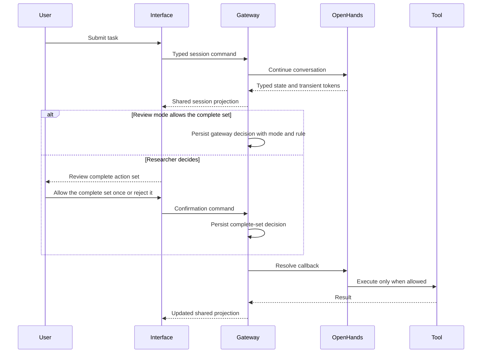

<!--
This source file is part of the Heartwood open-source project
SPDX-FileCopyrightText: 2026 Stanford University and the project authors (see CONTRIBUTORS.md)
SPDX-License-Identifier: MIT
-->

# Sessions and Audit

Heartwood separates presentation state from durable session evidence.
The gateway reduces one ordered event stream into the authoritative session projection used by terminal, browser, and notebook clients.

## Command Flow

## Persistence

Session directories contain metadata, event records, audit records, exports, and OpenHands persistence for that conversation.
Session identifiers are validated before any state path is created, and read-only replay of a new session creates no project state; the first mutating command registers the session.
The gateway incrementally translates persisted OpenHands messages, actions, observations, lifecycle, task, usage, specialist, and error state into Heartwood events.
While a run is executing or publishing its final events, its live publisher owns event delivery, and read-side reconciliation waits for it so it cannot consume an observation before live reproduction evidence is recorded.
After the publisher exits, reconciliation can recover persisted events without claiming that replay observed their execution.
Except for a service's first read, reconciliation reads the backend without the session command lock and journals what it read only if no event was appended and the worker attempt was neither fenced nor replaced meanwhile.
The session command lock is granted in the order it is requested, so reads that follow one another cannot keep a command, fencing, or revocation waiting.
Token deltas stay in process memory.

### Writer Ownership

The gateway acquires an interprocess writer lease before mutating a session and keeps it until it closes that session service.
A second process cannot reconcile or mutate the session until the owner releases the lease or exits; distinct sessions have independent leases.
If a worker does not stop during shutdown, the gateway keeps the lease rather than let another writer continue.
A closed session service rejects further commands and discards later backend callbacks; this fence does not terminate an independently running worker.
Mutation acquires the writer lease before the paired-snapshot lock, and recovery and replay never wait for a writer lease while holding that lock.

Managed worker attempts use the same lease and journal; their launch, fencing, revocation, reconciliation, and replacement are described in [Worker Attempt Ownership](system.md#worker-attempt-ownership).
Launch, revocation, and service shutdown are serialized apart from command and event handling, so shutdown cannot release writer ownership while a launch may still return.
Events and tokens from a revoked attempt's callbacks are discarded because they do not hold the current lease.

### Maintenance and Migration

An internal maintenance context holds the session-root admission lock and every existing session writer lock; an active writer prevents it from starting.
Migration staging additionally excludes gateway startup and requires every registered gateway lifetime lease, and an unresolved inference launch intent also blocks it.
Staging verifies paired session and audit histories and command receipts, copies their original bytes into a private directory on the destination volume, verifies the copy again, and records file hashes and session heads in a receipt.
Pending append recovery, unresolved commands, corrupt records, symbolic links, and existing destinations prevent staging, and worker recovery state, writer metadata, and derived exports are not promoted.
A retry uses a fresh staging directory and never adopts an earlier partial copy.

`heartwood project migrate --deployment MANIFEST` builds on that copy, validates configuration, experiment history, and installed Skill content, and stages the remaining canonical state and model artifacts.
It refuses active or unresolved work, including recorded Python experiments, which hold the same project lifetime lease as gateways and inference runtimes.
After verifying the staged bytes it records recovery evidence, fences local startup, retires the original directory into a protected backup, and publishes the external state.
Managed startup then requires the exact operator binding and a matching completion receipt; the local fence can deny local startup but cannot authorize external state.
`heartwood project recover-migration --deployment MANIFEST` resumes an interrupted publication or restores the preserved original while the target is unchanged; neither path removes the backup.
Gateway versions that do not use these locks must be stopped before maintenance.

### Storage Requirements

Session state must reside on storage that implements process-shared native advisory locks.
Heartwood disables existence-lock fallback because it cannot provide the same automatic release after process termination.
Local disks, attached persistent disks, and qualified project filesystems are the intended locations; object-store and file-transfer mounts are not session stores unless their native-lock behavior has been qualified.

### Command Receipts

Every command has an opaque identifier and a durable receipt.
An exact retry of a completed command returns its original event range without repeating a model call, confirmation callback, or tool action, and reusing the identifier with different content is rejected.
If a process stops after accepting a command but before recording its completion, Heartwood refuses to execute that identifier again unless durable state establishes its exact outcome.
An interrupted approval is completed automatically only when its recorded intent and OpenHands state prove whether the complete action set was resolved.
After the decision's checkpoint boundary and before OpenHands receives an approved set, the session durably journals an `action_dispatch.started` record.
An interrupted approval without that record never reached OpenHands: recovery sends it once if the pending set still matches, and withdraws an interrupted gateway decision that its rule no longer allows.
An interrupted approval with that record but without its resolution has an unknown outcome (`HW-AGENT-006`) and is never sent again or withdrawn.
Each `approval.recorded` event states that its dispatch is journaled; an interrupted approval without that statement was written before dispatch records existed, may have been sent, and is recovered the same way.
OpenHands saves conversation state only when a step ends, so a conversation reloaded after a stop during an approved step can show the set as pending again although it ran.
Otherwise the session rejects further mutation, so a second approval or task cannot repeat an uncertain side effect; verify the evidence and continue in a new session.

Outside decisions distinguish authorization from dispatch: an `authorized` record proves the native call has not started, and a `submitting` record means its outcome may be uncertain.
When checkpoint evidence is configured, in either mode, the authorization checkpoint must be retained before submission is recorded.
An authorization that could not be sent is dispatched only by an exact retry of its own approval command, with the same identifier and content, a live matching worker, and renewed input, policy, and expiry checks.
Denying the same review withdraws it, and an authorization that outlives its validity interval is recorded as expired; both close the original approval command so the session can continue.
Reconciliation records only such expiry and never turns an observation into submission authority.

### Append Recovery

Each session event and its audit record are committed through a private recovery journal.
After an interrupted append, the next writer verifies the journal, hash links, and existing records before completing only the missing write; malformed or inconsistent recovery state fails closed.
After process loss, a persisted OpenHands `RUNNING` state is reported as an unknown outcome and is never resumed or repeated automatically.

## Persisted Schema Compatibility

Every current independently persisted Heartwood envelope declares a schema version.
Supported legacy inputs are migrated before typed validation.
The project state marker records the current versions for project configuration, session events and metadata, command receipts, commit recovery, writer ownership, audit events, Skill metadata, and OpenHands state.
A shared migration registry provides one deterministic, forward-only path for each supported older version without mutating its input.

Project-state migration runs under the initialization lock and replaces metadata atomically.
Domain loaders apply the same registry before typed validation, so migration routing cannot bypass the record owner.
Unknown versions, migration cycles, nondeterministic transforms, malformed records, and unsupported fields fail closed without including persisted content in error messages.

OpenHands persistence records the exact SDK version and Heartwood content-minimization policy that wrote the state.
Heartwood validates that marker before reading or rewriting conversation events.
An SDK change therefore requires an explicit, tested migration instead of silently adopting possibly incompatible state.
When no migration is supported, Heartwood leaves the saved OpenHands records unchanged and reports `HW-AGENT-013`.
The session history remains available for inspection; new work can start in a new session in the same project.
SDK profile and provider-connection storage is scoped to private conversation state rather than a global OpenHands installation.

## Action Decisions

OpenHands can supply several proposed tool calls through one confirmation callback.
Heartwood displays every member as one action set and applies one decision to the complete set; it does not imply that members can be approved independently.
The complete proposal and confirmation request must already be durable before the gateway accepts a decision.
If native pending state arrives ahead of its live publisher, a decision is rejected without resolving the callback; a fresh command can be submitted after publication.
The gateway commits that complete-set decision before OpenHands can continue into model or tool execution.
The pending set is reconstructed from unmatched OpenHands actions after restart rather than from a separate Heartwood cache.
Its identifier contains a full SHA-256 digest of the ordered tool-call identifiers, native action identifiers, tool names, action kinds, and exact structured arguments.
Canonical JSON makes object-key order irrelevant while preserving list and action order.
Changed arguments, substituted tools, or added actions require a different decision even when tool-call identifiers are reused.
Advisory risk labels and presentation summaries are not execution authority and do not change this binding.
The gateway and backend both compare the current binding before resolving a decision.
This binds the proposed action content; it does not freeze files referenced by a command or establish an outside security boundary for local tool execution.
An approval identifier without the complete action-content binding is invalid; preserved history does not authorize new execution.

An action is recorded as approved only when the session holds a recorded decision for its action set.
A gateway decision under a [review mode](system.md#action-review-and-review-modes) is such a record: an accepted command and an `approval.recorded` event with the actor `gateway` and the applied mode and rule, followed by the same checkpoint boundary, digest check, and resolution events as a researcher decision.
The projection labels an action as decided only from these records and names the rule for a gateway decision.
If a backend reports executing an action without one, the session records an error and fences the worker attempt.
A set with a recorded approval or a started dispatch may have run, so it refuses a further approval, rejection, or gateway decision from every interface.
After a session owner starts, reconciliation checks whether OpenHands shows such a set as pending again, and records `HW-AGENT-006` for it once.
The check ends with the first read of a readable conversation, and a set sent by the same session owner is not counted, because it can look pending until its step starts.
A read that fails, or a conversation that cannot be opened yet, leaves the check for a later reconciliation, and reads and commands continue.
A session in an isolated worker is not checked: only the session owner that launched its worker can read the worker's conversation, and a replacement worker starts with an empty conversation.
Rejecting a pending set that was not approved remains available.

Each OpenHands proposal becomes one `heartwood.action-record.v1` projection correlated by stable action and tool-call identifiers.
The same record accumulates its group, decision, execution state, bounded result, and typed affected-path evidence across replay.
Terminal, file-editor, Task, and other actions use typed variants, while the exact OpenHands arguments remain available for review.
Gateway-issued outside operations and result releases use their own typed variants, which carry the destination or model route and the size, digest, and bounded preview of the content being sent.
Each record states whether its summary was written by the model or issued by the gateway.
Unknown outcomes fail closed and are never converted into a successful result by an interface.

## Audit Integrity

Audit records are chained so replay and export detect corruption, and any modification, reordering, or removal made without recomputing the chain.
The chain uses no key, so a process that can write canonical state can rewrite records and recompute it.
With the local backend, an approved command runs with the gateway's identity and can reach `.heartwood/`; a managed worker is admitted only without mounts that overlap the external state.
The trusted gateway can still write its state, so external placement does not replace independently retained checkpoints.
Only a signed checkpoint binds the history, and only as it stood when the checkpoint was signed.
Each content-minimized audit record also authenticates the corresponding complete session event by hash; replay requires matching counts, sequence, type, time, chain link, and event hash.
The recovery journal repairs a verified interrupted two-file append before replay, while tampered or unexplained mismatches fail closed.
Standalone JSON Lines appenders serialize writers with a native lock and use a durable journal to recover an absent, partial, or completely written final record without duplication.
Normal append validates the chain head needed for the next record; replay, verification, export, and checkpoint operations verify the complete available history.
The export path is itself recorded as an event.

A deployment can create a canonical checkpoint outside the project through the provider-neutral `CheckpointSigner` contract.
The signed payload binds the audit digest, event count, terminal hash, session, deployment identifier, creation time, retention declaration, signer identity, key identity, key version, algorithm, and public-key fingerprint.
Managed deployments resolve an approved HTTPS signer and independently trusted public key from one deployment-owned registry; project state stores only the selected profile identifier.
The explicit development and offline fallback uses the same contract through an authenticated Unix socket in an owner-only directory, with an owner-only Ed25519 key.
Verification requires the active deployment profile or a public key obtained through an independent trust path and rejects noncanonical or unexpected bundle content.
The chain and signature cannot prove that an intact suffix was not deleted before checkpoint creation.
An operator-bound evidence controller additionally verifies the complete independently retained checkpoint history and requires each successor to extend the retained audit prefix.
This detects rewriting or truncation of that prefix; it does not authenticate unobserved events or prove the completeness of activity after the last retained checkpoint.
The [managed evidence contract](../operate/audit-checkpoints.md#automatic-evidence-boundaries) defines publication, retention observation and required-mode recovery.
The retention declaration also does not implement storage lifecycle controls; the deployment records system remains responsible for authoritative storage and policy enforcement.

Exact action arguments, commands, affected paths, file content, patches, tool output, and failure text stay out of the content-minimized audit payload.
Model-route decisions keep the route's declared [data handling](../models/index.md#data-and-compliance-boundary): destination, retention authority and route description, with no credential reference or value.
Scientific code, input, environment, and output declarations belong in separate [experiment records](experiments.md), not in the security audit payload.
An operator-requested checkpoint can retain their exact project export as a separate file, with only its digest, byte count, filename, and binding version recorded in the terminal audit-export event.
The existing signature then binds that snapshot through the audit hash, without changing the signer protocol or asserting scientific correctness.
The log still cannot make every operational identifier, decision, classification, count, or timestamp non-sensitive.
Deployments must define retention, access, export, and deletion policy.
See [Audit Checkpoints and Retention](../operate/audit-checkpoints.md) for the operator contract.

## Long Conversations

The OpenHands SDK backend receives explicit model input and output budgets.
A rolling-history condenser uses the same authorized model route to summarize older history before the active context exceeds the configured budget, while recent events and the condensed summary remain available to the agent.

Agent and condenser calls use separate usage identifiers and do not bypass model-route policy.
The shared projection reports each purpose and a combined total without storing completion content in usage events.

## Tasks and Specialists

OpenHands Task Tracker updates supply the title and status of each plan item.
Free-form task notes are not copied into Heartwood session or audit events.

Specialist work is represented with its specialist name, task identifier, status, parent session, and parent action.
The parent OpenHands conversation remains authoritative and receives the specialist result before continuing.
Each invocation uses its child conversation UUID for task identity, preventing usage and lineage collisions after the parent restarts.
Sequential execution is the default.
Qualified parallel advisory reviews use the same workflow journal and grouped action policy.
The journal binds consent to the workflow revision, artifact snapshot, reviewers, budget, and qualification evidence.
Before dispatch, the gateway rechecks that binding and records the exact native event and tool-call identities with action fingerprints.
The security audit contains the review record's digest, not delegated instructions or returned prose.

Admission uses the existing paired event and audit append recovery protocol.
An interrupted admission can be recovered as a durable record, but is never permission to dispatch the same batch again.
Late callbacks must still own the active session lease and must not be cancelled; they cannot reacquire a released lease.

## Move Between Interfaces

Heartwood enforces one writer for each session.
Close or stop the active terminal, browser gateway, or notebook writer before continuing that session from another process.
The next process can then acquire the lease and continue the same authoritative event sequence.
Use distinct session identifiers when interfaces must remain active side by side.
