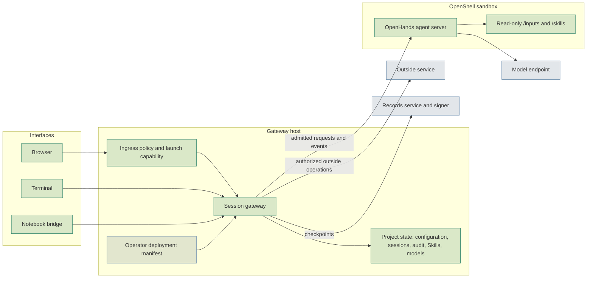

<!--
This source file is part of the Heartwood open-source project
SPDX-FileCopyrightText: 2026 Stanford University and the project authors (see CONTRIBUTORS.md)
SPDX-License-Identifier: MIT
-->

# System Architecture

Heartwood has three parts: a gateway that owns project state and every decision, an OpenHands agent worker that proposes and runs actions, and terminal, browser, and notebook interfaces that render the gateway's projections.
The worker runs either in the gateway process (the local backend) or as a managed native worker in an OpenShell sandbox.
Everything the worker returns crosses a trust boundary at the gateway before it can change a session, reach an outside service, or reach the model.

Green marks what Heartwood supplies and blue marks what the operator, research environment, or provider supplies, as in the [Platform Contract](../operate/platform-contract.md).
The local backend has no sandbox: the agent's tools run in the gateway process with the researcher's operating-system identity.

## Gateway

`SessionGateway` is the only path from an interface to an agent.
It owns:

- the project context, persisted configuration, and the effective policy profile;
- one `SessionService` per session, with its command receipts, paired event and audit journal, and writer lease;
- action review decisions and the [review modes](#action-review-and-review-modes);
- [authorization of outside operations and result releases](#outside-operations-and-result-releases);
- worker attempts, their admission, and revocation;
- audit export and checkpoint evidence;
- the Skill, specialist, workflow, model, and workspace services described under [Gateway Services](#gateway-services); and
- the session projection and researcher-facing labels that every interface renders.

OpenHands owns the agent loop, conversation persistence, coding tools, Task Tracker, and specialist execution.
The gateway configures it through the public SDK and does not keep a parallel agent loop, pending-action cache, or tool implementation.
The default tool list is the terminal, the project file editor, Task Tracker, and the sequential Task tool, with a global tool concurrency of one.
Model switching, Model Context Protocol servers, critic refinement, and automatic model routing are disabled.
OpenHands is the only retry owner for model calls, with at most three attempts for a remote route and two for a local one.

### Process Ownership

Project configuration writes take a project-scoped interprocess lock.
Each gateway registers a lifetime lease for the project before serving calls; leases of different gateways are independent, so separate sessions run concurrently.
Session mutation takes a separate writer lease, held by the gateway process that first handles a command for that session until its session service closes.
Two processes therefore cannot fork one session; interfaces continue a session sequentially or use different session identifiers.
Writer metadata left by a stopped process is treated as stale only after the operating-system lock is acquired.
These locks coordinate gateway processes; they do not stop older binaries or separately supervised inference runtimes.

Shutdown closes admission to the gateway API, waits up to five seconds for accepted calls, and then stops model transfers and session services.
If work is still active, shutdown reports failure and keeps session ownership and the gateway lease so it can be retried; REST requests to a stopped gateway return `503`.

## Agent Worker

Both execution modes implement the same backend contract, so session commands, review, journaling, and projections do not depend on where the agent runs.

### Local Backend

The local backend creates an OpenHands `LocalConversation` over the research directory in the gateway process.
It is the default for `heartwood`, `heartwood gateway serve` without `--deployment`, and the notebook bridge.

The local backend does not isolate anything.
An approved terminal command runs with the researcher's operating-system identity and can read or change any file that identity can, including `.heartwood/` state, audit records, and model credentials available to the process.
The audit chain detects accidental damage, but such a command can rewrite records and recompute the chain.
For that reason `review-outside-effects` is never in force outside a sandbox, and `review-changes` applies only when the model route needs no credential or uses a qualified platform-isolated transport ([Model Credentials](#model-credentials)).

### Managed Native Worker

`heartwood gateway serve --deployment MANIFEST` selects the managed worker when the [deployment manifest](#protected-state-and-the-deployment-manifest) contains a `worker` table.
No other launch path selects it, and a managed session never falls back to the local backend.
This section describes the worker of the Docker reference driver, `driver = "openshell-docker"`, and names the differences of `driver = "openshell-kubernetes"`.

The worker is the OpenHands agent server from the Heartwood worker image, started by `images/worker/launch.py` as user `10001`.
Before starting the server it registers the image's own verified advisory specialists.
It runs in an OpenShell sandbox created through OpenShell's Docker or Kubernetes driver, with `/inputs` and `/skills` mounted read-only and `/workspace` as its working directory.
With `openshell-kubernetes`, the driver mounts the sandbox's workspace claim at `/sandbox`, and `/workspace` is the image's own directory on the container's writable layer.
Files the worker writes to `/workspace` on this driver are lost when the container restarts.
The sandbox has no network of its own (`network=none`); its only routes are those the OpenShell policy and supervisor permit.

The gateway reaches the worker through an `openshell forward service` tunnel on loopback and authenticates every request with a per-attempt `SESSION_API_KEY`.
The remote conversation uses Heartwood's agent settings and tool construction; gateway-local parallel-review executors are not installed in the worker, so specialists there run sequentially.
Admission refuses a worker whose mounts reach protected state, the research directory, the native configuration home, or the Docker socket.

## Trust Boundary

The managed worker and everything it returns are untrusted.
The gateway admits a worker, binds it to one durable attempt, bounds what it may send, and validates each response and event before the SDK or the session sees it.
Four things cross the boundary: the launch and admission of a worker, the attempt binding that every request carries, the budgets and deadlines on worker traffic, and the admission of individual responses and events.

### Worker Admission

Launch happens once per session service, on the session's first backend read:

1. The session policy evaluates the worker's inference endpoint, credential reference, and capability tier; a denied route reaches no platform callback.
   The route must also equal the manifest's `profile_id`, `model`, and `model_endpoint`.
2. The gateway stages the manifest's `inputs` (at most 128 files, 16 MiB each and 64 MiB in total) and a [Skill projection](skills.md#worker-projection) into a private directory under the state root.
   One input identity digest binds the inputs, the Skill selection, the specialist catalog fingerprint, and any client-tool specifications.
3. The session journals the attempt intent before any sandbox exists.
4. The launcher connects to the registered OpenShell gateway with its mutual TLS identity, reads its info, and requires exactly one compute driver, of the implementation the manifest's `driver` selects, that reports both [deletion capabilities](../operate/platform-requirements.md#gateway-behavior-behind-native-qualification) revocation evidence depends on.
   A missing capability or an unreadable report stops serving at start with `HW-WORKER-001`, and stops a later launch or reconciliation before any sandbox, volume, or deletion request.
   A launch refused this way reports `HW-WORKER-001` in the session and is recorded as revoked without a created worker.
   The decision and the reported gateway version, driver, and capabilities are retained with the attempt: an accepted report in its runtime binding and revocation evidence, a refused one in its revocation evidence.
   The capabilities are the gateway's own report; Heartwood does not test the deletion behavior itself.
5. A short-lived preparation container copies the staged snapshots into two attempt-owned Docker volumes.
   It runs only the image's `chmod` with no network, a read-only root filesystem, all capabilities dropped except `FOWNER`, and `no-new-privileges`.
6. OpenShell creates the sandbox with the pinned image digest, the operator's policy, the provider attachment, CPU and memory limits, and attempt labels.
7. The launcher admits the sandbox only when OpenShell reports the expected identity, labels, ready phase, main-process generation, and an accepted configuration whose policy hash equals `sandbox_policy_sha256`.
8. Docker inspection of the worker container must report the pinned image, `NetworkMode: none`, no privilege, no added capability, and exactly one read-only volume at each of `/inputs` and `/skills`.
9. A probe inside the worker must report the expected file digests, read-only projections, no `/workspace/.heartwood`, user `10001`, the expected specialist catalog fingerprint, and an `openshell:resolve:env:` inference placeholder.
10. The forwarded API must answer with the attempt key and refuse a request without it, and the sandbox is admitted once more before the binding is returned.

Steps 5, 6, and 8 describe the `openshell-docker` driver.
With `openshell-kubernetes`, step 5 is [Kubernetes Worker Staging](#kubernetes-worker-staging), step 6 references the worker image as `<image_repository>@<image_digest>` and passes the two claims as read-only driver volumes, and step 8 is [Kubernetes Worker Admission](#kubernetes-worker-admission).

The operator's policy file must match `policy_file_sha256`, require Landlock as a hard requirement, run as `10001:10001`, and list `/inputs` and `/skills` as read-only.
With the Kubernetes driver it must also list `/workspace` as writable.

Container inspection accepts only listed confinement values: the container's own process and user namespaces, a private or absent IPC namespace, a private cgroup namespace, and security options that keep the default profiles, add `no-new-privileges`, or select the default AppArmor profile.
It also requires every capability to be dropped, `no-new-privileges` to be set, no device, device request, or device rule, and no bind mount or other mount that is not a Docker volume.
An SELinux label is accepted only for `container_t`, the confined type of container-selinux v2.251.0, or a single sensitivity level with individual categories; the former alias `svirt_lxc_net_t`, which only the base policy defines, is rejected.
The reported CPU and memory limits must equal the manifest's `cpu` and `memory`, and a process limit must be set.
The qualified sandbox gateway sets all of these on the Docker reference platform, including its default limit of 2048 processes; a Docker host with cgroup version 1, where containers share the host's cgroup namespace, is refused.
Every field must be present in Docker's report; an absent field fails admission.
A mount whose host source overlaps the research directory, protected state, native configuration home, or Docker socket is rejected.
Sources are compared as written, after normalization, and as resolved on the gateway host; a runtime that reports paths from another filesystem namespace is checked only in the written forms.
Every other mount must be a Docker volume.

The gateway version check compares the operator's declaration with the gateway's own report.
It catches a misconfigured deployment, not a gateway that misreports its version or lacks the behavior Heartwood's revocation evidence depends on.
The patched OpenShell gateway Heartwood builds exists only for qualification ([Build and Qualification](#build-and-qualification)).

### Kubernetes Worker Admission

With the `openshell-kubernetes` driver, each sandbox is a workload pod that runs the worker and a supervisor pod that mediates its connections.
The Kubernetes admission reads these objects with `kubectl` from the manifest's `namespace`: the workload pod, the supervisor pod, the per-sandbox NetworkPolicy `os-control-<sandbox id>`, the namespace-wide NetworkPolicy `openshell-sandbox-workloads`, every other NetworkPolicy of the namespace, and the namespace.
It uses the manifest's `kubectl_cli` and `kubeconfig` and no inherited Kubernetes or proxy configuration.
A missing or unreadable object, or an object reported under another name, kind, or namespace, fails admission.
The table lists the accepted values next to the values Docker inspection accepts.

| Property | Docker container | Kubernetes pods |
|---|---|---|
| Identity | Container name of the attempt; labels for project, attempt, and role `worker` | Workload pod named `<workspace>--<worker name>`; labels for project, attempt, role `worker`, sandbox, and boundary role; one controlling owner reference to the Sandbox resource of the same name |
| Supervisor | Not a separate container | Supervisor pod `os-supervisor-<sandbox id>` with the sandbox labels and an owner reference to the same Sandbox resource, by name and UID |
| Containers | One container | Workload pod: container `agent` and init containers `openshell-sandbox-bootstrap` and `workspace-init`, in that order; supervisor pod: container `supervisor`; no ephemeral container in either pod |
| Image | `Image` equals `image_digest` | `agent` and `workspace-init` use `image_digest`, `openshell-sandbox-bootstrap` uses `sandbox_image_digest`, and `supervisor` uses `supervisor_image_digest`; each `image` is a reference by digest, and each `imageID` in the pod status carries the same digest; the digest is the registry digest the pod references, where Docker reports the local image identifier |
| Network | `NetworkMode` is `none` | `hostNetwork` is false; both NetworkPolicies have exactly the driver's rules, and `os-control-<sandbox id>` is owned by the same Sandbox resource |
| Privilege | `Privileged` is false | `privileged` is false on every container |
| Capabilities | `CapAdd` is empty and `CapDrop` contains `ALL` | `capabilities.drop` contains `ALL` and `capabilities.add` has no entry, on every container |
| Privilege escalation | `no-new-privileges` is set | `allowPrivilegeEscalation` is false on every container |
| Seccomp | No option that replaces the default profile | Pod `seccompProfile.type` is `RuntimeDefault`; a container profile, when set, is the same |
| AppArmor and SELinux | Only AppArmor `docker-default` or an SELinux `container_t` label with individual categories | No `appArmorProfile`, AppArmor annotation, or `seLinuxOptions` on a pod or container, so the node's default applies; the effective profile is not reported |
| Other security settings | Not applicable | No security context field other than those in this table, `readOnlyRootFilesystem`, `fsGroupChangePolicy`, and `supplementalGroupsPolicy`; no sysctl other than `net.ipv4.ip_unprivileged_port_start`; no `runtimeClassName`; no host port; no restart policy on a container |
| Environment | Not inspected | No `envFrom` and no `valueFrom` entry, so no Secret or ConfigMap reaches a container through its environment |
| Process and IPC namespaces | `PidMode` and `IpcMode` are private | `hostPID` and `hostIPC` are false; `shareProcessNamespace` is false on the workload pod |
| User namespace | `UsernsMode` is empty | `hostUsers` is true |
| Cgroup namespace | `CgroupnsMode` is `private` | Not reported |
| User | Checked by the probe inside the worker | `runAsUser` and `runAsGroup` are `10001` and `runAsNonRoot` is true on every container and on the workload pod, and a pod-level `runAsUser` or `runAsGroup` on the supervisor pod is `10001`; `fsGroup` is `10001` on both pods, and neither lists another supplemental group |
| Service account token | Not applicable | `automountServiceAccountToken` is false on both pods; the supervisor pod's projected token has audience `openshell-gateway` |
| Devices | `Devices`, `DeviceRequests`, and `DeviceCgroupRules` are empty | No `volumeDevices`; requests and limits name only `cpu` and `memory` on every container and pod; no resource claim |
| CPU and memory | `NanoCpus` and `Memory` equal the manifest's `cpu` and `memory` | The limits of `agent` equal the manifest's `cpu` and `memory`, and its requests equal its limits; `resources` is present on every container |
| Process limit | `PidsLimit` is positive | Not reported |
| Volumes | No bind mount; only Docker volumes; no mount source that overlaps a withheld host location | Workload pod: exactly the volumes `inputs`, `skills`, and `workspace` (persistent volume claims), `openshell-runtime`, `openshell-runtime-state`, and `openshell-run` (`emptyDir`), `openshell-pod-identity` (`downwardAPI`), and `openshell-sandbox-bootstrap` (the sandbox's bootstrap Secret, mounted only by the init container of the same name); supervisor pod: only `emptyDir` volumes, the sandbox's `os-supervisor-<sandbox id>-` Secret, the gateway certificate Secret `openshell-client-tls`, projected service account token volumes, and, when the gateway is configured with additional certificate authorities, the volume `openshell-additional-ca` with the key `ca.crt` of a ConfigMap named `openshell-additional-ca-*` |
| Inputs and Skills | Exactly one read-only attempt volume at each of `/inputs` and `/skills` | Exactly one mount at each of `/inputs` and `/skills` in `agent`, without a sub-path or mount propagation; its claim is the attempt's claim, read-only on the volume and on every mount; every mount path in the pod is absolute and normalized |
| Namespace | Not applicable | Label `pod-security.kubernetes.io/enforce` is `restricted`, label `pod-security.kubernetes.io/enforce-version` is `latest` or absent, and the namespace is active |

The Kubernetes API server omits `hostNetwork`, `hostPID`, `hostIPC`, `privileged`, and `hostUsers` from a pod when they are unset, so these five fields are accepted when absent.
It also omits a list without entries, so `capabilities.add`, `volumeDevices`, `ephemeralContainers`, supplemental groups, resource claims, container ports, and the supervisor pod's init containers are accepted when absent or empty.
A setting the table excludes, such as `appArmorProfile` or `runtimeClassName`, must be absent.
Pod-level `resources` and a container's own `seccompProfile` are optional.
Every other listed field must be present with its accepted value.

NetworkPolicies add up, so admission refuses any other NetworkPolicy that selects the workload pod's labels and has an ingress or egress rule.
A policy without rules, such as a default denial, is accepted, and a selector that admission cannot evaluate fails admission.

`admission_record` in `heartwood.gateway.worker_kubernetes` returns the inspected values of both pods, the policies, and the namespace for qualification evidence, without environment, commands, or pod labels and annotations.
It keeps the namespace's Pod Security labels.
The launcher keeps the record of the latest inspection whose objects could all be read, accepted or refused, on the attempt's adapter.

### Kubernetes Worker Staging

With the `openshell-kubernetes` driver, `KubernetesWorkerVolumes` in `heartwood.gateway.worker_kubernetes` stages the snapshots into two persistent volume claims, `hw-attempt-<attempt>-inputs` and `hw-attempt-<attempt>-skills`, in the manifest's `namespace`.
The table lists each step next to the Docker step.

| Step | Docker | Kubernetes |
|---|---|---|
| Volumes | Two Docker volumes with the project, attempt, and role labels and the two OpenShell approval labels | Two claims with the same labels, storage class `heartwood-attempt`, access mode `ReadWriteOnce`, 256 MiB each, and no data source |
| Staging process | A container that never starts while the copy runs: no network, read-only root filesystem, all capabilities dropped except `FOWNER`, `no-new-privileges`, user `0` | Pod `hw-staging-<attempt>` from the worker image by digest: service account `hw-staging` without a mounted token, user and group `10002` without the user's groups from the image (`supplementalGroupsPolicy: Strict`), `RuntimeDefault` seccomp, no privilege escalation, all capabilities dropped, read-only root filesystem, CPU and memory limits, only the two claims as volumes, and a ten minute lifetime |
| Network | `--network=none` | Every NetworkPolicy of the namespace that selects the pod's labels must have no ingress and no egress rule, and together they must cover both directions; otherwise nothing is created |
| Copy | `docker container cp`, then `chmod -R a+rX` in the container | A tar stream of directories and regular files through `kubectl exec` into `tar` in the pod; files belong to user `10002`, are readable by every user, and keep whether they are executable |
| Completion | The container exited with status `0` and kept its identity | The pod kept its identity, is still running, and its container did not restart; then the pod is deleted and its absence is awaited |
| Identity | Volume and container labels are read back after creation and before removal | Claim and pod labels and UIDs are read back after creation, and the labels again before removal; a deletion request selects by name and by the labels |
| Read-only use | The worker mounts each volume read-only | The driver configuration names each claim read-only on the volume and on the mount |
| Removal | No container of the attempt may be listed; then the staging container and the volumes are removed | For up to 90 seconds the Sandbox resource `<workspace>--hw-<first 16 hex characters of the attempt>` and every pod of the attempt must become absent; then the staging pod and the claims are deleted and their absence is awaited |

A pod counts as the attempt's when it has the workload pod's or the supervisor pod's name, the attempt's labels, an owner reference to the attempt's Sandbox resource, or the sandbox identifier in `openshell.ai/boundary-pair` or `openshell.ai/sandbox-id`.
A failed or unreadable `kubectl` request stops staging, and staging is never repeated for an attempt; revocation removes what was created.
A missing or unreadable listing is never read as absence.

### Worker Attempt Ownership

A worker attempt is a durable record in the paired session and audit journal with the phases `prepared`, `active`, `fenced`, and `revoked`.
Its intent binds the project, session, native conversation, image digest, deployment policy, sandbox policy, and input identity.
Records contain no worker credentials.

The launcher returns a runtime binding (sandbox identity, process generation, endpoint, image, and policy), and the session issues a process-local lease for it.
Every HTTP request, event connection, and session callback requires a live lease that still owns the session writer.
The lease reobserves the sandbox through OpenShell before admission, reusing a passing observation for at most one second; a changed sandbox, generation, configuration, or a stopped forwarder fences the attempt.
Fencing closes HTTP, event, and callback admission at once, including responses already in flight.

The gateway fences an attempt when it observes an exhausted response budget, a missed request deadline, a failed admission or runtime observation, execution reported without a recorded decision, or session close.
Fencing starts revocation on its own thread, so no control-plane call runs under a session lock or on a transport thread.
Revocation does not wait for a session command whose worker request is in progress; it waits only for a control-plane launch of the same attempt to return, and is then bounded by the control-plane timeouts: 15 seconds to observe the sandbox, 90 seconds for the delete request, and 90 seconds to observe its absence.
It deletes the sandbox through the control client connected at launch, stops the forwarder, rechecks the native configuration, requires Docker to report no attempt-owned worker container, and removes the attempt's volumes before the session records `revoked` with its evidence.
With the Kubernetes driver, a deletion that the sandbox gateway could not complete is sent again, up to seven times within the 90 seconds of the delete request, after pauses of 0.5, 1, 2, 4, 8, and 16 seconds.
Only three answers are retried: an `INTERNAL` error that starts with `delete sandbox failed:`, which includes a concurrent change of the Sandbox resource, `FAILED_PRECONDITION`, which reports a pending operation, and `UNAVAILABLE`.
Before each retry the sandbox's name, labels, and identity are read again.
The cluster must then show neither the Sandbox resource nor any pod of the attempt, for which revocation waits up to 90 seconds, before the [claims are removed](#kubernetes-worker-staging).
Revocation reads the cluster's identity again before that and keeps the attempt fenced when it differs from the launch.
If revocation fails, the attempt stays fenced and the writer stays owned, and the worker can keep running until a retry succeeds: the managed session retries it, first after 15 seconds and then with the wait doubling up to 10 minutes, until revocation is observed, also after the session's service is closed, and the gateway stop and the next gateway start retry it too.
A fence is raised only when the gateway observes the condition, so a worker the gateway is not exchanging data with is not detected by this path.

A gateway that ends without revoking leaves its attempt in the journal.
`heartwood gateway serve --deployment` calls `SessionGateway.reconcile_workers` before serving: it fences each unrevoked attempt, deletes the sandbox only when its name, labels, and any retained sandbox identity match, verifies absence, removes owned volumes, and records the evidence.
It runs without the gateway state lock, so other sessions and settings do not wait for the control plane; a command to the session being reconciled is refused until it finishes.
Sessions whose attempt remains fenced are reported, each with a stable diagnostic.
A session whose revocation was not observed (`HW-WORKER-003`) is retried while the gateway runs, first after 30 seconds and then with the wait doubling up to 10 minutes, and its attempt remains fenced until revocation is observed.
Until then the gateway caches no service for that session: a read returns its journal and a command is refused, so no command takes the session out of the retry, and the first command after the observed revocation can admit a replacement.

Each attempt's launch intent records stable identities of the sandbox control plane and the container runtime it uses: the registered gateway's name, endpoint, and certificate authority, and the identity the Docker daemon behind the configured socket reports.
With the Kubernetes driver the second identity is a digest of the API server address and certificate authority in `kubeconfig`, the namespace's name and UID, and the manifest's `workspace`.
Launch refuses to proceed when either identity changed after preparation.
Reconciliation observes the infrastructure named by the current deployment manifest only when both identities match the attempt's record; otherwise the attempt stays fenced with `HW-WORKER-002` and nothing is observed or removed, because absence on other infrastructure is not evidence of revocation.
Attempt records are versioned: records written before launches retained these identities remain readable, name no infrastructure, and are never reconciled against the current one.
The qualified sandbox gateway answers a creation request with `INVALID_ARGUMENT`, `PERMISSION_DENIED` or `UNAUTHENTICATED` only before it records or requests the sandbox, so the gateway process that received such a rejection records later absence as `not-created`.
After any other failed or unanswered creation request, absence of the sandbox is never recorded as `not-created`; reconciliation treats an attempt without a recorded runtime the same way, because the process that received the response has ended.
The qualified sandbox gateway rejects deletion of a sandbox whose provisioning has not settled, but it does not report a creation request it has not recorded yet, so absence cannot show that such a request will not still create the sandbox.
The attempt therefore stays fenced and its revocation keeps being retried; a sandbox that appears under the attempt's unique name with its full identity is deleted, and the attempt is recorded as revoked.
With the Kubernetes driver and a sandbox gateway that reports `openshell.compute.create-rejects-deleted-name`, revocation asks the gateway by deleting the attempt's name with `allow_missing`.
The answer `ALREADY_ABSENT` records `not-created`, because that gateway rejects a later creation under the name.
A completed or accepted deletion is followed as the deletion of the sandbox whose identity the gateway returns, and records `revoked`.
Any other answer keeps the attempt fenced.
In both cases the cluster must also show no object of the attempt.
Resolving such an attempt from absence requires a sandbox gateway that rejects or reports later creations under a name whose absence it confirmed.
The native forwarder runs under a small supervisor in its own process group, which ends the whole group when the gateway's end of a pipe closes, so no forwarder outlives the gateway process, however that process ends.
OpenShell deletion is name-scoped rather than conditional on a generation; unique attempt names and identity checks do not replace control-plane authorization.

After a recorded revocation, a gateway configured to launch workers can start one replacement attempt with a new identity, key, placeholder, and response budget in a new sandbox.
The replacement starts a new conversation in an empty workspace; the session projection marks where it became active.
At that point the projection marks the earlier worker's unfinished tasks as superseded, and adds the earlier workers' reported model usage to the session total and lists it separately, because each new worker reports its usage from zero.
Replacement is refused while the journal holds work only the revoked worker's conversation could finish: an unsettled run, an unended pause, an action awaiting review, an unrecoverable outcome, or a non-terminal outside operation or result release.
While a revoked session is refused for one of these reasons, the shared projection carries the reason as a researcher notice, which the terminal, browser, and notebook present.
A gateway without a worker configuration refuses commands for a revoked session instead of running it locally; the session stays readable.
Once the journal records the revocation of the attempt a session's service launched, whichever path recorded it, a running gateway replaces that service at the session's next command, so the command can admit a replacement without a restart or configuration change.
A read alone does not replace or close the service or start a worker.
The revoked attempt's backend is closed with its service, and events that arrive from it after fencing are discarded.

### Budgets and Deadlines

Every worker attempt has one response budget shared by HTTP responses, connection attempts, and received events.
It allows bursts of 1,024 responses and 32 MiB and refills at four responses and 1 MiB per second.
Each response is charged its size or 16 bytes per parsed value, whichever is larger; received events are charged by size.
Resetting the HTTP client does not replenish the budget, and a replacement attempt receives a new one.

Each request has one wall-clock deadline of 120 seconds from connection to the last body byte, so slow status lines, headers, interim responses, or chunk framing cannot extend it.
A response body is limited to 4 MiB, or 16 MiB for a branch snapshot, and to 524,288 JSON values counted before parsing.
A walk through paged history ends when a page identifier repeats or after 1,024 pages or 32 MiB.
Exhausting the budget, missing a deadline, or returning a history that does not end fences the attempt.

These limits bound what the gateway receives, about 70 MiB of peak memory for one response; they do not bound work inside the worker.
The branch a session retains between reads is bounded like the snapshot that would carry it, 16 MiB of serialized events and 524,288 values, so the conversation can always be attached from one snapshot; a branch that would grow beyond that fences the attempt.
The SDK keeps its own cache of every event it admits, including logged state updates, and at the end of each run reads the complete history again into that cache.
Each such walk is bounded like any other, to 1,024 pages and 32 MiB of serialized events, and a walk beyond that fences the attempt, so a session whose complete history outgrows the walk bound is fenced at its next run end.
A session's gateway memory for worker progress is therefore bounded by the retained branch, up to 16 MiB and 524,288 values; the SDK's cache, up to the 32 MiB its last complete walk admitted plus the events received over the event connection since then, which only the response budget's rate bounds until the run ends; and the response being admitted, at most about 70 MiB at the value limit.
A routine read transfers the status, whose reported usage grows with the number of model calls up to the 4 MiB response limit, and the new events.
The event connection has no deadline of its own: it is idle while a session waits for its researcher, its handshake is limited to ten seconds, and keepalive closes a connection whose peer stops answering.
Reconciliation reads the worker without holding the session command lock or the gateway state lock, including a session's first read, which opens the conversation and can launch the worker.
First reads of one session run one at a time, and a read that finds the session's worker preparation under way returns its journal instead of waiting; launch reads Skill and configuration state outside the gateway lock, and a change to either replaces the session's service, which revokes an attempt launched from the earlier state and launches again on the next read.
A worker session's command runs without the gateway state and configuration locks and releases the session command lock while each of its requests to the worker is answered.
Until the command's records are complete, no other command, read, or callback of that session journals, so its acceptance, events, and completion receipt stay together and a retried command waits and then replays its result instead of being sent again.
Fencing and revocation journal during that wait; a worker answer that arrives after its attempt's admission closed is discarded, the command records that the worker stopped, and it sends no further request.
A request waiting for its response ends as soon as its attempt is fenced, without waiting for the deadline.
Closing a session waits for its command in progress and holds no lock that revocation needs.
A worker session's close never asks the control plane on the caller's thread: once the session has prepared a worker, its revocation, preparation release and service close run on the managed session's own thread, after any preparation, launch or prompt revocation under way, and revoke any attempt a launch created before it connects.
A setting or Skill change therefore saves the change under the gateway state lock and reports it at once; the services it replaces are detached, and no control-plane call runs under that lock.
Until the close finishes, the session stays owned, a read returns its journal, and a command waits at most 10 seconds and is otherwise refused as retryable.
While the attempt's revocation is not observed, the close retries it with the same backoff as a prompt revocation, so the session stays fenced and refused until the control plane answers and needs no reset or stop.
A close that fails after revocation was recorded, such as in native client shutdown, caches the service again, and its next command replaces it.
The gateway stop gives each close one more attempt and waits at most 30 seconds for each; a close that still fails leaves the session owned, and a later stop or the next gateway start retries it.
A local session's commands keep the gateway locks, so a project setting change from another gateway waits for its turn; a worker session's command does not hold them, and a setting change applies to its next command.

### Response and Event Admission

Responses must be uncompressed UTF-8 JSON with unique keys and finite numbers, on the configured origin, without redirects, ambient proxies, or server-selected client tools.
Every event in a page or snapshot must validate as a native OpenHands event before the SDK receives it.
The returned tool registrations must equal the exact tool-name and module pairs and client-tool specifications from trusted configuration on create, attach, resume, and fork.

Conversation metadata is admitted field by field against the creation request the gateway sent.
Fields the request sets, including the agent, security analyzer, confirmation policy, hooks, workspace, iteration limit, and secret registry, are admitted only when they equal the sent values.
A fixed set of reported fields such as status, usage, identifiers, and timestamps is admitted as data, and any other field is rejected.
A worker therefore cannot select the agent implementation, model route, analyzer, or secret source the gateway constructs.

The event connection permits only the origin's canonical conversation endpoint without credentials in the URL, query, or fragment, verifies TLS against bundled certificate authorities, limits messages to 4 MiB, and queues at most four frames.
Binary messages and completion-log events are rejected.
Admission errors never include worker response content.

### Progress Reads

Admitted event callbacks coalesce progress reads, token deltas do not request one, and a five-second fallback refresh and final reconciliation preserve progress and settled state.
The first read of a conversation, at creation or attachment, is one native branch snapshot with the conversation identity, active events, execution status, and reported usage.
Later reads first request the conversation's execution status and reported usage from the worker, admitted like any other response, and then only the history after the admitted leaf, starting at the leaf itself.
The status the agent server reports is the state it last saved, and a change made during a step is saved only when the step releases the conversation, so that status can be older than the events; the state the SDK caches from its event connection is not used, because it can lag the worker.
The agent server logs every status change as a state update when it makes the change, so the latest status logged in the history the gateway has read replaces the reported one, and a read never reports a status older than one already read.
A read returns a status only with the events it describes; when concurrent reads overlap, a read that would return a later status than its own events returns the longer branch already retained.
Each later read must begin with the admitted leaf unchanged, and each event after it must name the previous branch event as its parent; logged state updates name the branch tip but are not part of the branch.
A repeated, missing, reordered, replaced, or forked event fences the attempt, as does a snapshot for another conversation or a branch that does not chain from its root.
Admission parses and validates each response once, and the gateway's branch reads use those validated events.
The adapter does not mutate the worker's context view; navigation to another branch is not supported, and pending-action recovery belongs to the worker runtime.

A worker acknowledgement means a proposal was dispatched, not that an outside effect was authorized or completed.
Admission failure does not stop the worker; revocation through the sandbox control plane does.

### Model Credentials

The managed worker receives only an `openshell:resolve:env:` placeholder; the provider credential stays in the OpenShell control plane, which resolves it at request time.
Credential expiry, model allowlists, and tenant restrictions are provider and inference-service settings; the selected model name and a provider attachment do not enforce them against a compromised worker.

For the local backend the gateway classifies the route against the platform capability as credential-free, application-scrubbed, or platform-isolated.
An application-scrubbed route keeps provider material out of tool inputs, durable state, and projections, but the model client and the tools still share one operating-system identity, so every action is reviewed.
A platform-isolated route requires a separately authorized transport and live synthetic qualification.

## Action Review and Review Modes

OpenHands pauses before every action set (`AlwaysConfirm`), and the session service decides whether the set waits for the researcher.
The OpenHands policy-rail and pattern analyzers rate each action from its typed content; a rating can send an action to the researcher but never allow one, and the model's own risk field is not an input.
A decision applies to the complete action set and is bound to a digest of its exact content ([Action Decisions](sessions-audit.md#action-decisions)).

The gateway classifies each action from its type: a file-editor `view` of a path it resolved inside the project is `read`, a Task Tracker update is `plan`, any other file-editor or terminal action is `workspace`, and everything else is `other`.
Terminal commands are never classified by their text.

| Mode | The gateway allows a set without the researcher when | Available |
|---|---|---|
| `review-all` | never | always; every fail-closed path falls back to it |
| `review-changes` | every action is `read`, or every action is `plan`, with a low or medium analyzer rating | in a sandbox, or locally when the model route needs no credential or is platform-isolated |
| `review-outside-effects` | every action is `read`, `plan`, or `workspace` with a low or medium rating, in an admitted sandbox | only while the session's worker attempt is active and admitted |

A set always waits for the researcher when it contains an outside operation, a result release, or a tool bound to an outside service, when its proposal is not yet durable, when the researcher paused the session or the run stopped, or when the worker's admission failed.
Any unknown classification or unreadable setting selects researcher review.

The researcher selects a mode with `--review-mode`, `/permissions`, browser settings, or `PUT /settings/actions/review`; without a selection the mode is `review-outside-effects` in a sandbox when the ceiling permits it, and `review-all` otherwise.
The policy profile's `allowed_action_review_modes` is the ceiling; [Deployment Ceiling](../operate/security.md#deployment-ceiling) describes the built-in defaults and how manifest and project lists combine.

A gateway decision is recorded like a researcher decision: an accepted command and an `approval.recorded` event with the actor `gateway` and the applied mode and rule (`read.file-view`, `plan.task-tracker`, or `sandbox.contained`), followed by the same checkpoint boundary and resolution events.
If the worker reports executing an action without such a record, the session records an error and fences the attempt.
Under `review-outside-effects`, containment of automatically allowed actions rests on the OpenShell policy and on outside-operation admission, not on per-action review.
The [action-review evaluation](testing.md#action-review-evaluation) is the evidence a deployment needs before listing a mode.

## Outside Operations and Result Releases

An outside operation is a worker tool call that would change state in a platform service.
A result release sends an outside observation back to the worker's model.
Both always require a researcher decision bound to exact content; no review mode allows them automatically.

The outside service adapter (`ExternalActionAdapter`) is a trusted dependency an embedding launcher supplies to `SessionGateway` through `external_actions_factory`.
`heartwood gateway serve` installs none; native qualification uses a synthetic authenticated MCP service.
The [Platform Contract](../operate/platform-contract.md) defines the messages an adapter exchanges.

An outside operation proceeds through these steps:

1. The worker proposes a call to a tool the adapter lists.
   The adapter resolves it into a canonical request of at most 64 KiB with at most 16 immutable input references totalling at most 16 MiB, without performing an effect.
2. The gateway issues an `ExternalActionProposal` binding the operation identity, the worker attempt, the proposing event, the service policy digest, the request, and a validity interval, and presents it as an action with an `unknown` rating.
3. The researcher's decision binds the proposal's SHA-256 digest and permits one use.
   An approval is journaled and must be retained as checkpoint evidence before any dispatch.
4. Before dispatch the gateway rechecks the live worker lease, the policy digests, the adapter's policy and actor entitlement, expiry, and the input bytes, then records `submitting` and calls the adapter once.
5. The adapter's observation must name the same proposal, operation, project, and service.
   An uncertain dispatch is recorded as `unknown` and later resolved by status lookup, never by resubmission.

A platform operation adds to the request the platform project context its observations must report, and the reviewed description of the work: for a submission, the platform's proposal and the estimate it refers to; for a cancellation, the earlier operation it names.
The gateway proposes a cancellation only for an operation the session sent to the same service, and the identifier the service receives comes from that record ([Platform Job Operations](../operate/platform-contract.md#platform-job-operations)).

Only an exact retry of the approval command that recorded an authorization can dispatch it; a status read, reconciliation, another command, or an automatic decision cannot.
Denying the same review withdraws an undispatched authorization, and an authorization that outlives its interval is recorded as expired.

A result release is a separate proposal that binds the operation digest, the observation event, the sanitized content, the destination model route, and a validity interval.
After approval the adapter independently authorizes disclosure to that route, the worker must be idle with no pending review, and the gateway submits the content once as a user message wrapped in an `outside-result` envelope.
The envelope labels the data; it is not an instruction boundary, and the model can act on instructions in released content.

## Protected State and the Deployment Manifest

The process current directory is the research-file boundary, and no interface accepts another workspace path.
A local launch keeps project state in `.heartwood/` under it.
A managed launch binds the research directory to external state through an operator manifest with the schema `heartwood.project-deployment.v1`: the project UUID, the exact research directory, a `state_root` named by that UUID, the `policy` that is the project's default and ceiling, and optional `worker` and `evidence` tables ([Deployment Manifest](../reference/configuration.md#deployment-manifest)).

The gateway validates the manifest, its ownership and permissions, and every worker and evidence authority file before opening any store.
Project content can neither select a manifest nor supply deployment authority, and copying the research directory does not grant access to the original state.
A project's own policy may only narrow the manifest's, and broader or malformed persisted rules fail closed.
Without a manifest, the selected platform adapter supplies the default policy and no deployment ceiling applies.

`heartwood project migrate --deployment` moves local state into the external root, and `heartwood project recover-migration --deployment` resumes or reverses an interrupted move ([Persistence](sessions-audit.md#persistence)).
External placement keeps state out of the worker's mounts; operating-system identities still decide who else can read it, and the gateway can always write it.

## Audit, Checkpoints, and Evidence

Each session event and its content-minimized audit record are committed together through a recovery journal, and the audit chain links every record by hash.
The chain uses no key; only a signed checkpoint binds history, and only as it stood when it was signed ([Audit Integrity](sessions-audit.md#audit-integrity)).

With an `evidence` table, the gateway anchors every action-set decision, every outside decision, and session close as a checkpoint boundary.
It stages the audit prefix to an S3-compatible records service and has the signer from the deployment's signer registry publish the checkpoint.
In `required` mode a boundary returns only after the retained signature is read back, so an approved action or outside operation does not dispatch without it; in `buffered` mode an unavailable records service is recorded as a visible gap.
An approved outside operation always requires its checkpoint.
A session whose history contains checkpoint evidence refuses to dispatch from a gateway that lacks the records configuration.
[Audit Checkpoints and Retention](../operate/audit-checkpoints.md) defines the operator contract.

## Interfaces

The terminal, browser, and notebook bridge submit typed commands and render one gateway projection; they keep no event reducers or business rules of their own.

- The startup planner combines read-only readiness with platform capabilities and returns one phase: project review, connection required, credential required, model required, compute required, ready, or recovery required.
- Agent work runs in a supervised background thread, so an interface can guide, pause, resume, or review while a task is active.
  Final messages, actions, lifecycle changes, task plans, usage, specialist lineage, and errors become durable events; token text stays transient.
- The session projection contains the conversation, versioned action records, lifecycle, the complete pending action set, task plan, usage by purpose, specialist lineage, available commands, status, and bounded next-step suggestions.
  The gateway admits exactly the available commands the projection advertises, so a control an interface shows is never refused as unavailable.
  The projection's lifecycle, pause, unrecoverable errors, and open and retained reviews come from the same journal reduction that the session service uses for automatic review, approval gating, and worker replacement.
  A pause therefore stays in effect, whatever the backend reports, until the service accepts a researcher command that continues the agent: a recorded resume, chat or an approval whose first record is not a refusal, or a workflow command that reaches an allowed model route.
  A workflow command that sends no turn, such as a cancel, leaves the pause in effect.
  A refused command, a rejection, and the gateway's own decisions leave the pause and resume in effect.
  An open review is decided first: while one waits, only approval and rejection are available, and a pause it interrupted applies again after a rejection.
  A recoverable error recorded during a pause is shown in the conversation while the session stays paused.
  An error that makes further work unsafe ends steering and every review decision, even when it was recorded without changing the displayed lifecycle; only the withdrawal of a retained outside approval, which sends nothing, stays available.
- REST, server-sent events, and WebSocket return events and the projection from one serialized snapshot; a transient revision orders token-only updates.

`IngressPolicy` models direct loopback, a local Jupyter proxy, and an explicitly trusted proxy with one external origin and base path.
It rejects undeclared non-loopback exposure, untrusted forwarding metadata, origin and host mismatches, duplicate security headers, and ambiguous paths before a route runs.
Every REST, server-sent-event, and WebSocket request must carry the process-lifetime [launch capability](../operate/security.md#launch-capability), and the gateway derives the command actor from it.

### Platform Adapter

The selected adapter supplies environment detection, capabilities, ingress modes, the model-credential boundary, data-mount declarations, credential allowlists, and the default policy.
Generic, Terra, and Carina behavior differs only through these boundaries and their launch orchestration.
The versioned Heartwood–platform contract and its offline conformance checks are described in the [Platform Contract](../operate/platform-contract.md).

## Gateway Services

These services run in the gateway and share the session journal, review, and projection.

### Research Workflows

A versioned definition declares inputs, ordered stages, artifacts, deterministic checks, researcher gates, and work budgets, and references existing Skills and advisory specialists.
A stage is an ordinary OpenHands turn with normal action review; advancing requires settled work, resolved approvals, a structured outcome, and gateway-run checks against the exact input and output digests.
Model-reported success cannot replace a missing, failed, or stale check, and checks establish bounded properties, not scientific appropriateness.
Budgets are admission checks at observed boundaries, not spending caps.
See [Research Workflows](../use/research-workflows.md) and [Experiment Records](experiments.md).

### Independent Review

Advisory reviewers return structured proposals through OpenHands' `FinishTool`; the gateway verifies supported findings against captured evidence and keeps unverified proposals visibly separate.
A verified finding is an observation, not permission to correct, approve, or advance.

### Research Specialists

The catalog is loaded through OpenHands `AgentDefinition` and registered with the public Task tool.
The enabled planning and review roles are tool-free, inherit the parent's model route, and run sequentially; the project-action role is not registered because nested child actions cannot be reviewed through the public task interface.
Parallel advisory review requires deployment-supplied qualification evidence ([Qualify Parallel Reviews](../operate/parallel-reviews.md)).

### Skills

Signed catalog content and local directories are verified as complete trees, approved by exact digest, and passed to OpenHands as exact directories ([Skill Trust and Distribution](skills.md)).

### Model Artifacts

Catalog choices, Hugging Face downloads, raw imports, and portable bundles converge on one selection, resource planner, integrity verifier, and launcher.
Downloads pin an immutable revision, bundles are verified digest by digest before atomic publication under `models/`, and import requires an explicit license decision bound to the reviewed manifest.
The native inference launcher writes a durable launch intent before starting its child and removes it only after observing the child exit; an unresolved intent blocks another launch and migration until the operator reconciles it ([Troubleshooting](../reference/troubleshooting.md#managed-inference-outcome-is-unresolved)).

### Workspace Inspection

One bounded read-only service serves trees, text files, changed paths, and diffs, excluding `.heartwood/` and `.git/` at every depth and refusing symbolic links and special files.
Git projects use OpenHands `LocalWorkspace`; other projects report only paths changed by typed file-editor actions, never paths parsed from terminal text.

## Build and Qualification

The application's default lock installs patched OpenHands and OpenShell SDK wheels from `vendor/runtime-wheels/`, which is not committed.
`deploy/build-worker-candidate.py --bootstrap` builds them there from pinned upstream revisions, verified by the digest of their extracted source tree, and the reviewed patches in `images/worker/candidate/`, or verifies existing wheels against the digests in `sources.json`.
The patches add the remote-event and configuration-admission hooks the trust boundary requires; the gateway refuses to construct a managed worker on an SDK without them.

The OpenShell gateway is also built from pinned source with the deletion patches recorded in `images/worker/candidate/gateway.json`, as version `0.1.9+heartwood.2` with the purpose `qualification-only`; each patch makes the gateway report its behavior as a compute driver capability.
The build contains the Docker and Kubernetes compute drivers, and each gateway configuration in this repository selects one with `compute_driver`.
Heartwood ships no production OpenShell gateway: a deployment's gateway is checked only by the capabilities it reports, and it must separately provide the [behavior native qualification depends on](../operate/platform-requirements.md).

Native qualification runs the installed application, worker image, and qualification gateway through the complete boundary and produces commit-bound, verifiable evidence; [Testing and Evidence](testing.md) describes the cases, evidence, and verification.
Qualification uses synthetic data and does not establish sensitive-data readiness or institutional approval.
