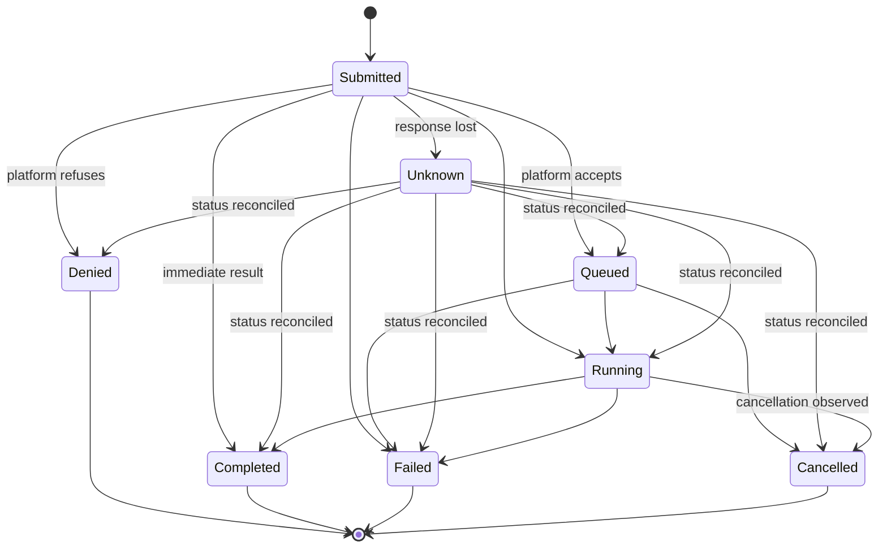
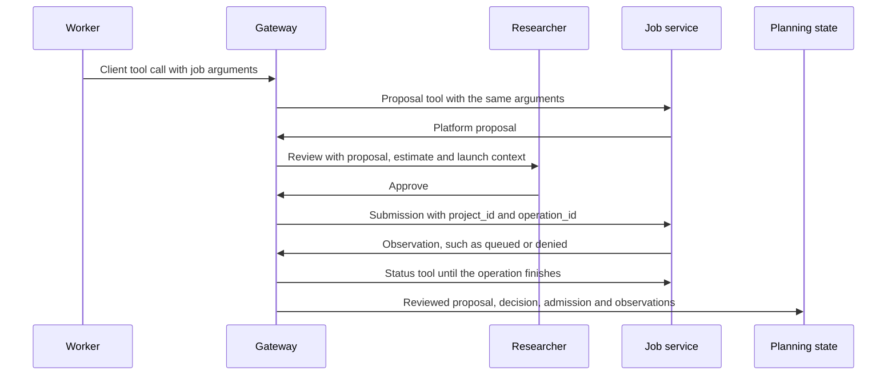
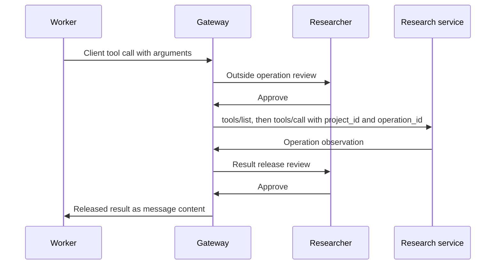

<!--
This source file is part of the Heartwood open-source project
SPDX-FileCopyrightText: 2026 Stanford University and the project authors (see CONTRIBUTORS.md)
SPDX-License-Identifier: MIT
-->

# Platform Contract

A research platform can embed Heartwood as its research interaction layer while keeping authority over identity, compute, storage, inference and spending.
This contract states what each side provides, how the contract is versioned, and how to check an integration against it.
[Platform API and Access Requirements](platform-requirements.md) turns it into an access request for a specific platform.

Each part is marked with one status:

- **Current**: implemented, tested, and exported as a current artifact.
- **Draft**: an exported schema with offline checks; Heartwood does not send or consume the message at runtime.
- **Unavailable**: neither implemented nor exported.

A schema describes a message; it does not enable a service, authorize a request, or establish that a deployment is qualified.

## Scope and Status

| Part | Status |
|---|---|
| [Hosting](#hosting) the published artifact with persistent project storage | Current |
| [Access and identity](#access-and-identity) through an authenticated proxy and the launch capability | Current for one launching principal per gateway |
| [Deployment policy](#deployment-policy) bound by the operator deployment manifest | Current |
| [Inference](#inference) through built-in and operator-configured routes | Current; connection-manifest startup unavailable; model metadata draft |
| [Agent isolation](#agent-isolation) of the complete worker | Current for the OpenShell Docker reference adapter; qualified only against the [sandbox gateway build](platform-requirements.md#sandbox-gateway) |
| [Controlled data](#controlled-data) controls | Selected read-only inputs current; quarantine and steward-approved release unavailable |
| [Audit and records](#audit-and-records) | Signed checkpoints and deployment-bound evidence current; signer and records-service qualification is the platform's |
| [Platform services](#platform-services) over MCP, outside operations, launch context and budgets | Draft; the content-bound [outside operation](#outside-operation-admission) authorization, [research MCP servers](#research-mcp-servers), [platform job operations](#platform-job-operations) and [planning against platform budgets](#planning-against-platform-budgets) are current; `heartwood gateway serve` installs a planning service only from a deployment manifest's `[planning]` table |
| Verified OpenID Connect identity of one researcher per gateway, with `identity-proxy` ingress | Current, implemented and tested locally with a synthetic provider |
| Launch of hosted per-project gateways by a platform | Current in the Kubernetes reference platform in `reference-platform/`, which starts one gateway per researcher and project with JupyterHub; tested on a local cluster without a model route for workers |
| Realtime voice | Unavailable |

## Responsibilities

| Area | Heartwood | Platform |
|---|---|---|
| Researcher identity | Records the launching principal, or with `identity-proxy` ingress an actor derived from the verified issuer and subject, as the actor of every accepted command and ignores actors claimed in requests | Authenticates the person or operates the identity provider, authorizes project access, ends the session |
| Gateway access | Requires the launch capability on every request and validates the declared ingress route | Routes only authenticated users to the gateway, strips client-supplied forwarding and identity headers, terminates TLS, delivers the capability |
| Research session | Owns canonical session records, action review, outside authorization and interface projections | Keeps the gateway, research files, protected state and network route available |
| Policy | Evaluates model routes, review modes and credential references against the deployment ceiling | Defines the ceiling and enforces filesystem, process and network restrictions |
| Inference | Selects an authorized route; keeps credentials out of model context, tool inputs, events and exports | Operates endpoints, enforces account, model and tenant authorization, data-use agreements and spend limits |
| Agent isolation | Admits, fences and revokes worker attempts; admits worker responses against what it sent | Provides the sandbox, its control plane, and credential substitution outside the worker |
| Platform services | Defines draft messages and offline checks; binds outside operations to researcher decisions | Authorizes every call; owns scheduling, quotas, cost, entitlements and infrastructure policy |
| Project and billing context | Binds the research directory and state through the deployment manifest | Selects the platform project and billing or grant attribution |
| Audit and provenance | Writes content-minimized audit and experiment records and requests signed checkpoints | Authorizes the signer, retains records immutably, keeps its own operation audit |
| Controlled data | Makes no compliance claim | Decides data eligibility, agreements, egress, monitoring and incident response |

Platform authentication does not replace gateway controls, and a Heartwood approval never grants platform authority.

## Interfaces

| Direction | Interface | Authority |
|---|---|---|
| Researcher interface → gateway | Generated gateway OpenAPI, server-sent events and WebSocket | Gateway validates ingress, capability, commands and approvals |
| Worker → inference transport → provider | Existing provider API and model identifiers | Transport holds the credential and routes; provider authorizes account, model and tenant |
| Trusted adapter → platform service | Existing platform APIs; optionally MCP under the draft profile | Platform authenticates each call and enforces project, dataset, compute and billing permissions |
| Launcher → sandbox infrastructure | Existing infrastructure control API | Operator owns admission, policy, runtime identity and revocation |
| Gateway → signer and records service | Checkpoint-signing HTTPS interface and S3-compatible object storage | Signer authorizes publication; records service enforces scoped access and retention |

The contract reuses existing standards and adds only what Heartwood needs:

| Area | Upstream definition | Heartwood addition |
|---|---|---|
| Inference | Provider APIs supported by the SDK, including Chat Completions and Responses | Route eligibility, model metadata declarations |
| Platform tools | MCP discovery, calls, results, errors and capabilities | Required annotations, policy checks, review of side effects |
| Jobs, workflows and data | Native scheduler and storage APIs; GA4GH TES, WES and DRS where supported | References linking native resources to proposals, estimates and audit records |
| Cost | FOCUS definitions | Workload assumptions, estimate coverage and validity, budget observations |
| Asynchronous results | MCP Tasks extension, revision 2026-07-28 | Estimate payload carried in task results |

Upstream definitions stay authoritative for their own messages, streaming, errors and lifecycle; the bundle pins their revisions instead of copying them.

## Platform Responsibilities

### Hosting

Required:

- Run the published image or native release without replacing its entrypoint, user or bundled browser assets.
- Provide persistent research storage and separate state storage with native advisory locks; object-store and file-transfer mounts are not session stores unless qualified.
- Keep model weights, credentials and deployment secrets out of image layers and the project directory.
- Keep the owner-only Unix sockets and directories of a Heartwood-managed model server and of a local checkpoint signer outside worker access.

Recommended:

- Verify the release's build attestations before admitting an artifact, and back up project storage across compute replacement.

Optional:

- Provide Jupyter where the platform offers the [notebook bridge](../use/notebooks.md).

Releases carry build attestations; separate artifact signatures, software bills of materials and third-party notice bundles are unavailable for release images and native assets.

| Topology | Runs the gateway | Authenticates the person | Status |
|---|---|---|---|
| Workstation or container | The researcher | The operating system and the launch link | Current |
| Platform workspace | The platform, in the researcher's workspace | The platform proxy | Current for the Terra terminal and notebook and the Stanford Carina terminal, CI validated |
| Hosted per-project service | The platform, one gateway per researcher and project | The institution's identity provider, verified by Heartwood | Identity verification current, implemented and tested locally with a synthetic provider; platform launch current in the Kubernetes reference platform, tested on a local cluster without a model route for workers |

Gateway shutdown does not stop external jobs or storage charges.

### Access and Identity

Required:

- Authenticate every user before traffic reaches the gateway, and restrict the gateway's network route to the platform proxy.
- Remove client-supplied forwarding and identity headers before setting the proxy's own values.
- Deliver the launch capability, either by letting the researcher open the one-time launch link, or by injecting `X-Heartwood-Capability` for requests the platform has already authenticated.
- Keep the capability away from the agent workspace, the worker, other users and logs.

Recommended:

- Run one gateway per researcher and project; Heartwood records one launching principal per gateway and does not distinguish people who share it.
- Serve mutually untrusted projects on separate origins; base paths on one origin do not isolate browser storage.

A proxy that injects the capability authenticates on the researcher's behalf and must do so only for the user who owns that gateway.
For example, a proxy at `https://research.example.org` that strips the prefix `/heartwood/project-a` and connects from `10.0.0.2` starts the gateway with a secret from its secret manager:

```bash
heartwood gateway serve --capability-fd 3 3</run/secrets/heartwood-capability \
  --ingress-mode trusted-proxy \
  --host 10.0.0.5 \
  --port 8767 \
  --public-origin https://research.example.org \
  --base-path /heartwood/project-a \
  --trusted-proxy-source 10.0.0.2/32 \
  --proxy-strips-prefix
```

The proxy then adds `X-Heartwood-Capability` with the same secret to each authenticated request.
[Gateway Ingress](security.md#gateway-ingress) and [Launch Capability](security.md#launch-capability) state the exact validation rules, and the [command reference](../reference/cli.md#gateway-serve) lists every serve option.

A platform whose proxy forwards requests without authenticating them starts the gateway with `identity-proxy` ingress.
The gateway then signs the researcher in at the institution's OpenID Connect provider and accepts only the issuer and subject bound in the manifest, in whatever form the provider issues the subject, as [Researcher Identity](security.md#researcher-identity) describes.

### Deployment Policy

Required:

- Bind each managed project through an operator-owned [deployment manifest](index.md#deployment-manifest) outside research files and state.
- List exact model and catalog endpoints, credential references and permitted review modes, with egress denied by default.
- Enforce filesystem, process and network restrictions outside Heartwood; policy validation cannot constrain a compromised process.

Recommended:

- List only `review-all` in `allowed_action_review_modes` until each further mode has been evaluated for the platform; the default when the key is omitted permits the platform's modes, plus `review-outside-effects` with a worker.

Optional:

- Publish approved Skill sources through the deployment-owned registry at `/etc/heartwood/skill-sources.toml`; only that registry can approve a Skill for controlled data.

Project settings can narrow the ceiling but cannot widen endpoints, credentials, capability tiers, review modes or permitted data destinations, remove a deployment's data-destination list, lower the aggregate-count floor, disable default-deny egress or change the platform identifier.
Without a manifest, the platform adapter's built-in policy applies and state stays in the research directory.

### Inference

Required:

- An OpenAI-compatible Chat Completions endpoint with streaming and native tool calls for compatible services; provider-specific routes keep their SDK-supported protocols.
- A model list endpoint that returns only the models the authenticated identity may use.
- Platform-held credentials, through a managed identity, a process-only variable or a mounted file outside the project.
- A statement of which data classes each route may receive; compatibility does not establish eligibility.
- A declaration of each connection's [data handling](#route-data-handling): where the complete route sends model requests and who governs retention of the content it receives.
- Distinguishable failures for rejected credentials, exhausted quota, rate limits, invalid model configuration and temporary unavailability.

Required for isolated workers:

- An outside inference transport that substitutes the credential, provider-side enforcement of the approved account, model set and tenant even when several models share one hostname, and an operator-configured credential lifetime and rotation; Heartwood sets no expiry on it.

Recommended:

- The Responses API where the model supports it; Heartwood selects the protocol per model from the deployment's declaration, or else from the OpenHands model capabilities.

Optional:

- Compute on which Heartwood [runs a managed model](../models/run-with-heartwood.md), and an approved process to [import verified model bundles](../models/offline.md).

Heartwood discovers models through a policy-checked catalog endpoint and never implements a second provider proxy.
A deployment supplies its connections in `heartwood.model-connections.v1` and its model declarations in `heartwood.platform-model-metadata.v1`, both inside the [deployment manifest](../reference/configuration.md#model-connections).
The gateway loads them at start; a later change to either stops dispatch until the next start.
The model list shows only the models the endpoint returns for the deployment's credential; a declaration never adds a model to it.
Choosing, selecting or saving a model on a platform connection rereads the list, so a withdrawn model cannot be chosen again.
A selected model that the platform later withdraws stays selected, and its next model call fails with the platform's model error.

The draft model-metadata supplement declares, per model identity:

| Field | Meaning | Level |
|---|---|---|
| Model identifier | The exact value sent in each request | Required |
| Protocols | Chat Completions, Responses or both | Required |
| Context and token limits | Context window and input and output limits; missing values stay unknown | Recommended |
| Tool calling | Whether native tool calls are supported | Required |
| Data classes | Classes the route may receive under the platform's agreements | Required |
| Deprecation | Whether the model is being withdrawn, so no model is silently substituted | Recommended |

Heartwood uses a declaration in place of the OpenHands model table for that model.
A declared model with a supported protocol is listed as available and selected at the `supervised` capability tier, as a model the OpenHands SDK verifies would be.
Protocols name the OpenHands API modes `chat` and `responses`.
One declared mode selects the request path, and the policy-checked endpoint, for every request; with both, OpenHands chooses.
A model whose declaration names neither is listed as unavailable and cannot be selected.
The declared input limit, or else the context window less the output limit, sets the agent's input limit; the output limit sets its output limit; OpenHands resolves a limit that is not declared.
Tool calling sets whether OpenHands uses native tool calls.
Model setup shows the declared context window and tool support, and reports an undeclared value as unknown.
The data classes in a declaration are informational, and Heartwood does not act on them.

#### Route Data Handling

A connection's `data_handling` descriptor declares the `destination` of model requests, its `retention_authority` and a `route` description, such as an institution's gateway followed by the providers it routes to.

| Destination | Meaning |
|---|---|
| `same-compute` | The inference service runs in the compute environment that runs the Heartwood project |
| `institution-managed` | An institution-operated service, such as an inference gateway, receives the requests |
| `provider` | The model provider's service receives the requests directly |
| `operator-defined` | A service whose handling its operator defines outside these classes |

Retention authority is `deployment`, `institution`, `provider` or `service-operator`.
Built-in connections supply descriptors; a platform supplies one for each connection through the `data_handling` field of the `heartwood.model-connections.v1` manifest, and a connection without one is undeclared.
The descriptor is a declaration by the connection's owner; Heartwood does not verify provider behavior, retention or data eligibility from it, and does not infer it from endpoint URLs.
Describe the complete route: an outside credential-substituting transport such as an OpenShell proxy does not change the declared recipient.

Setup responses expose the descriptor and a shared summary for every connection and for the active route.
Each `model_call.decision.recorded` event, which precedes the model work it authorizes, records the descriptor of the route the session uses, and the scrubbed audit export retains it without credentials.
Each worker attempt records the descriptor of the route it was launched for with its other launch identities.
A policy's `allowed_data_destinations` restricts routes to the listed destinations: selection and each model call fail closed when a route's descriptor is missing or names another destination.
A project policy can narrow the list but cannot remove or widen a deployment's list.

### Agent Isolation

For an isolated worker, the platform provides:

Required:

- A sandbox with mandatory filesystem and process restrictions, resource limits, deny-by-default network enforcement, and a control plane the worker cannot reach.
- Read-only projections of selected inputs and verified Skills, a private writable workspace, and no research-directory, protected-state or Docker-socket mount.
- Provider credentials, signing authority, launch capabilities, management sockets and peer-worker state outside worker access.
- Authenticated admission bound to project, session, attempt and runtime identity, with a changed generation or configuration fencing the old attempt.
- Revocation observed outside the worker before replacement or writer release, with reconciliation instead of duplicate execution when creation or deletion is uncertain.
- A sandbox gateway that provides the [deletion behavior native qualification depends on](platform-requirements.md#sandbox-gateway), and reports the three required capabilities for the one compute driver the manifest's `driver` selects.

The reference adapter uses OpenShell on a local Docker engine with the native OpenHands remote conversation, workspace and event contracts.
OpenShell names, policy objects and control credentials belong to that adapter, not to portable platform messages; another adapter must keep the same authority, lifecycle and evidence properties on its own infrastructure.
Worker-reported events and output are untrusted: they cannot create approvals, authorize platform operations or prove that the worker has stopped.
[Sandbox Enforcement](security.md#sandbox-enforcement) and [Gateway Enforcement](security.md#gateway-enforcement) divide these controls between the two sides.

### Controlled Data

Required:

- Decide data eligibility for every model route, dataset and interface.
- Provide read-only input snapshots, enforced egress denial and ephemeral, encrypted execution storage for controlled work.
- Keep outputs in quarantine until an authorized data steward approves an exact release manifest.

Heartwood provides the selected-input transfer: the manifest's `[worker.inputs]` binds each file's path, size and SHA-256, at most 128 files, 16 MiB per file and 64 MiB in total.
Staging rereads and verifies the bytes, rejects symbolic links, multiply linked and nonregular files, excludes `.git` and `.heartwood`, and uses a private directory outside the project that is removed when staging ends.
File digests establish content identity, not authorization to disclose the content.
Heartwood provides no quarantine, encrypted storage or steward-approved release, and is not a controlled-data boundary on its own; see [Security and Controlled Data](security.md).

### Audit and Records

Recommended:

- A deployment-owned checkpoint signer, installed through `/etc/heartwood/checkpoint-signers.toml` or `HEARTWOOD_CHECKPOINT_SIGNER_REGISTRY`, with keys no agent can use.
- Retention, immutability and deletion enforcement for exported audit and experiment records.

Required for managed evidence:

- An independently authorized signer that retains each checkpoint before returning it, and a versioned, retention-locked records service with separate identities for the gateway and the signer.

Required for platform services:

- An operation audit log joinable to Heartwood's audit by operation reference.

The signer interface is `POST /v1/checkpoints/sign`, accepting `heartwood.audit-checkpoint-sign-request.v1` and returning `heartwood.audit-checkpoint-signature.v1` over HTTPS.
[Audit Checkpoints and Retention](audit-checkpoints.md) defines the registry, the evidence table and the storage permissions.

### Platform Services

The service, operation, task and budget messages are draft.
The agent's OpenHands configuration contains no MCP server.
The gateway is the MCP client: [research MCP servers](#research-mcp-servers) reach the worker only as reviewed outside operations.

#### Service Discovery

Required:

- Expose services over MCP Streamable HTTP with a stable server identity.
- Describe each tool's purpose, input and output schemas, and required permission; read access never implies permission to allocate resources or attach data.
  A [platform job service](#platform-job-operations) declares its operations and permissions in `heartwood.platform-operation-capabilities.v1`.
- Annotate each tool with explicit boolean `readOnlyHint`, `destructiveHint`, `idempotentHint` and `openWorldHint` values.
- Enforce identity, quotas and dataset entitlements on every call, independently of Heartwood's approval.
- Accept delegated or platform-held credentials that never reach model context, tool environments or exports.
- For a hosted gateway, accept the [exchanged service token](#service-tokens) and derive the project from it.

#### Service Tokens

A gateway with [`identity-proxy` ingress](security.md#researcher-identity) obtains the token for a platform service by OAuth token exchange, when the service's [destination](../reference/configuration.md#mcp-destinations) declares one.
The gateway authenticates as the project's client and sends the researcher's access token as the subject token, with the scope and the audience the manifest names for that service.

| Claim | Value | The service checks |
|---|---|---|
| `iss` | The identity provider | Equal to its configured issuer, with the provider's signature |
| `aud` | One audience, the service's own | Equal to its own audience |
| `azp` | The project's client, `hw-proj-<project>` | The project it acts for, derived from this claim and never from a request field |
| `sub` | The researcher | Membership and entitlement in that project |
| `exp` | No later than the researcher's token | Unexpired |

The service does not forward the token.
The identity provider decides which client may request which scope and audience; an audience requested without its scope, a scope requested with another service's audience and another project's client are refused there.

Annotations are hints from the server, not authorization, and a changed tool set requires a new review.

#### Operations That Change Platform State

A tool that allocates compute, submits work, attaches data or starts an application is an operation.

Required:

- Before approval, return a proposal with resource limits, expected duration, estimated cost when available, data scope and destination.
  A platform job service returns `heartwood.platform-operation-proposal.v1`, and Heartwood adds the estimate from its planning state.
- Accept a caller-supplied operation identifier, scoped to the authorized project and service and bound to the exact proposal; a repeat with the same contents is the same operation, and different contents under the same identifier are a conflict.
- An estimate or preparation call that persists data, incurs charges or reserves resources follows the normal review and authorization path.
- Report status by operation identifier, so an uncertain outcome is reconciled rather than resubmitted.
- Report cancellation as the observed result, without promising rollback.
  A cancellation is its own operation that names the earlier one by `target_operation_id`.
- Return a reference that joins the platform's audit record to Heartwood's session audit without copying payloads.



These states are what Heartwood shows; keep native backend states and references alongside them.
`Unknown` means Heartwood has no authoritative observation, not that nothing happened, and a cancelled operation can leave completed work and incurred charges.

#### Asynchronous Results

Pending results use the [MCP Tasks extension, revision 2026-07-28](https://tasks.extensions.modelcontextprotocol.io/specification/2026-07-28/tasks), exported unchanged with its pinned commit, checksum and license.

- The server advertises `io.modelcontextprotocol/tasks` under `capabilities.extensions`, and each task-enabled `tools/call` opts in through `params._meta["io.modelcontextprotocol/clientCapabilities"].extensions`.
- A call returns either the immediate tool result or a flat `resultType: "task"` handle.
- `tasks/get` returns status and, when completed, the original tool result, whose `structuredContent` uses the same estimate schema as the immediate path.
- `tasks/update` supplies requested input and does not bypass review or authorization.
- `tasks/cancel` acknowledges a request; observe the task, backend operation and spending separately afterward.

A completed task can carry a tool result with `isError: true`.
Expired or missing task state requires reconciliation by operation identifier before resubmission.
`mcp-tasks.SOURCE.txt` records where the profile interprets differences between upstream prose and examples.

#### Launch Context, Budgets and Estimates

The platform owns project selection, billing attribution, spending thresholds, reservations, accounting and enforcement.
Heartwood compares estimates the platform produces; it does not price work, monitor spending or cap bills.
A draft `heartwood.platform-launch-context.v1` document carries the platform-owned binding:

```json
{
  "schema_version": "heartwood.platform-launch-context.v1",
  "project_context_id": "launch-synthetic-1",
  "platform_id": "synthetic-platform",
  "project_id": "research-project-a",
  "billing_attribution_ref": "binding-a",
  "authority_ref": "platform-authority",
  "policy_ref": "policy-v1",
  "issued_at": "2026-10-17T10:00:00Z"
}
```

Keep it outside agent-writable state; possession of a copy does not authenticate its issuer.
It is separate from the deployment manifest, which binds only the research directory, state and policy.

A planning service offers budget observations and estimates to Heartwood.

Required:

- Derive the project context and billing attribution of every record from the caller's authenticated project, never from a value in the request.
- Produce estimates from the platform's own prices for a whole plan or for named elements, and report work it does not estimate as unknown cost with a limitation.
- Return a new estimate identity for each quote.

Optional:

- Serve both capabilities as MCP tools annotated read-only: `get_budgets` with argument `project_id`, returning `{"budgets": [...]}` budget observations, and `estimate_workload` with `project_id`, `scope`, `prediction` and `element_ids`, returning one estimate.
  Heartwood's MCP planning client calls a tool only when the server lists it with `readOnlyHint` true; an estimate that persists data, charges or reserves follows the [operation](#operations-that-change-platform-state) path instead.

`fixtures/synthetic/platform-contract/` contains a complete exchange for an exploration, a batch and an inference workload, plus `mcp-tasks.json` with immediate and deferred estimates and a cancellation followed by continued backend work.
Read each exchange in this order:

1. `prediction`: quantities, units, assumptions and project-local evidence for one plan revision.
2. `estimates`: platform prices for that prediction; `scope` distinguishes a plan from an element quote, and `coverage` states how complete the cost information is.
3. `operation_sets`: exact native-request references, hard limits and embedded estimate snapshots for review.
4. `researcher_decisions`: the decision bound to the proposal revision and document hash; the platform's own decision is in `authorizations`.
5. `operations` and `budgets`: separately observed execution and accounting state, including unknown or stale values.

Rules for these messages:

- An estimate total already includes components marked `included_in_total`; separate estimates for the same work are alternatives, not additive charges.
- Amounts are decimal strings; `null` is unknown and `"0"` is an explicit zero; denominations must match before comparison, and Heartwood performs no conversion.
- The proposal digest is SHA-256 over the exact UTF-8 document bytes, not a canonical JSON form; reserializing requires a new binding and decision.
- `reviewed_operation_set()` rejects duplicate JSON keys, and `verify_reviewed_operation_set()` checks a stored envelope against the original bytes.
- An estimate, a researcher approval, a platform authorization and a spending reservation are distinct states, and approving a plan does not authorize each operation in it.

Price and cost fields reuse FOCUS definitions from the SKU Price proposal at revision `005a30566a754db4e0f346d20c7063daba579080` and the estimation-features proposal at revision `a2f9f93cb618ab490b90098d0456dfcdb813c5e7`; these are draft references, not a claim of FOCUS 1.5 conformance.

| Requirement | FOCUS definition or boundary |
|---|---|
| Rate amount and basis | `UnitPrice` and `UnitPriceType`, preserving decimal precision and distinguishing list, base and contracted rates |
| Measurement scale | `PricingUnit`; a token count is not a million-token pricing quantity |
| Denomination | `PricingCurrency`, distinguishing currency or credits from resource quantities |
| Price identity and period | The SKU Price dataset's provider, SKU, contract and price-period context |
| Price eligibility | `SkuPriceEligibility`, which describes pricing, not authority to use a resource |
| Workload, coverage and decisions | Heartwood interaction records, not FOCUS columns |
| Observation time and estimate expiry | Platform interaction records, not the price's effective period |

## Heartwood Responsibilities

### Gateway API

`gateway.openapi.json` defines every REST operation, the launch-token exchange, server-sent events and, under `x-websocket`, the WebSocket transport, generated from the typed contracts.
The [Gateway API reference](../reference/gateway-api.md) explains command envelopes, approval targets, retries and recovery.

- HTTP requests carry `X-Heartwood-Capability`; capability cookies are not accepted.
- A browser WebSocket sends `{"type": "authenticate", "capability": "…"}` as its first frame within five seconds; a trusted proxy may inject the header instead.
- Clients resume streams with the `after` query cursor; `Last-Event-ID` replay is not implemented.
- During shutdown, new REST and event-stream requests receive `503`, WebSockets close with code `1012`, and the terminal exits with code `75`; reconnect to the next gateway with the last cursor.
- Project maintenance or a conflicting owner returns `409` or closes WebSockets with `1012`; it is not permission to start a second writer.
- Session command payloads are JSON objects validated by their command handlers.

Proxies must support unbuffered streaming and WebSocket upgrades.
A successful HTTP exchange does not establish that an asynchronous research action completed.

### Outside Operation Admission

A trusted Python embedding can connect platform services to the research session.
It supplies a session-scoped `ExternalActionAdapter` through `SessionGateway(external_actions_factory=...)` and the SDK `ClientToolSpec` definitions through `native_worker_plan_factory(client_tools=...)`.
The worker registers those tools; their acknowledgement proposes an operation and does not execute it.
`heartwood gateway serve` installs one adapter, for [research MCP servers](#research-mcp-servers), when the deployment manifest lists MCP destinations.
The gateway has no HTTP route for registering other adapters or creating proposals; other services need an embedding launcher such as the native qualification fixture.

To offer outside operations, a platform or embedding launcher must provide:

- a launcher that constructs `SessionGateway` with protected state from a deployment manifest and an owned native worker;
- an `ExternalActionAdapter` implementation for its services, holding the service credentials outside the worker;
- the exact `ClientToolSpec` definitions for the proposal tools, whose canonical schemas are bound into the worker input identity;
- trusted input storage for `read_input` that does not follow worker-selected paths; and
- a destination service that authenticates the adapter and enforces entitlement, project scope, expiry and idempotency itself.

The adapter's contract:

- `prepare` resolves the native request and immutable input references with no external effect;
- `check_policy` and `check_result_policy` raise when current policy or the actor's entitlement forbids dispatch or disclosure;
- `read_input` returns bounded bytes from trusted storage, which the gateway verifies before use;
- `submit` sends once and independently enforces actor, project, live attempt, policy, expiry and content binding, so a repeated operation identifier never creates a second effect;
- `observe` queries an existing operation without submitting; and
- `prepare_result` returns sanitized JSON through the service's own authorization, without credentials.

`SessionService.propose_external_action` turns a retained worker proposal into a review with a gateway-issued operation identifier, the complete request, input digests, destination, worker identity, policy revision and a five-minute validity interval.
The approve and deny commands bind the full proposal digest.
While another operation on the same service is being submitted or has an unknown outcome, the gateway neither proposes nor sends another one; reconciliation through `observe` comes first.
Immediately before submission the gateway rechecks the live worker attempt, project, policy, actor entitlement, validity and input contents, and submits the verified bytes without reopening worker paths.

The decision and submission intent are journaled before the service is contacted; with managed evidence, the authorization is retained outside first, even in buffered mode.
An approved operation that could not be sent is sent only by an exact retry of its own approval command; status reads, reconciliation and automatic decisions never send it.
Denial withdraws an authorization that has not been submitted; an undispatched authorization that reaches the end of its validity interval is recorded as expired and never sent.
After a review expires, `propose_external_action` for the same worker proposal records the expiry and issues a new identifier and review.
`reconcile_external_actions` queries the existing operation after an interruption and never resubmits; an observation must match project, service, operation and proposal digest.
Denying an already submitted operation does not cancel it.

The audit records operation identifiers, digests, decisions and status without request or input payloads.
The service must independently authenticate the caller and enforce entitlement, project scope, attempt revocation, policy, expiry and idempotency, and the worker must have no other route to it.

### Result Release to the Worker

Approving an outside operation does not authorize disclosing its result.
`SessionService.propose_external_result` reads the result of a terminal, observed operation from the current worker attempt and opens a separate review that binds the exact result, the observation, worker identity, policy revision, declared model identifier and route, and a fresh five-minute validity interval.
Results are limited to 64 KiB including the provenance envelope, and ambiguous JSON is rejected.
Approval requires current disclosure policy, the live worker lease and an idle conversation.

The release reaches the model as a user-role message whose JSON envelope labels it as an outside result; that label is not an instruction boundary.
There is one open release review per operation, denial is final for it, and an interrupted delivery is never retried automatically.

### Planning Against Platform Budgets

A trusted Python embedding connects a planning service by passing `SessionGateway(platform_planning=PlatformPlanningBinding(launch, client))`.
`launch` is the platform's launch context and `client` a `PlanningServiceClient`, such as `McpPlanningClient` for the MCP tools above.
The gateway requires protected state for it.
`heartwood gateway serve` installs a binding from a deployment manifest's [`[planning]` table](../reference/configuration.md#planning-service): the launch context comes from an operator file, and each call carries a token exchanged for the signed-in researcher's token.
The other built-in launchers install none.
Without a binding, the planning projection reports that planning is not offered, and every interface hides it.

The gateway does the following and nothing more:

- **Discovery:** each refresh lists the service's capabilities and reads budgets only when the service offers them; an estimate is requested only when the last discovery found estimates offered, and a change in the service shows after the next refresh.
- **Plan revisions:** a workload prediction for the launch context is recorded once per revision; a changed revision under the same identity is refused, and a superseded revision must be recorded first.
- **Estimates:** the platform estimates a recorded revision as a whole plan or for named elements, and an answer for another project context, revision or scope is discarded.
- **Linked records:** `PlatformPlanning.link_operation_set` and `link_platform_record` attach the exact reviewed proposal bytes, researcher decisions with their session audit references, platform authorizations and operation observations to the revision they belong to.
  The contract overview's validator checks every link; the embedding is responsible for passing only records it obtained from the session's action review or from the platform.
- **Projection:** `GET /project/planning`, `/plan` in the terminal and `NotebookSession.planning()` show one `heartwood.planning-projection.v1` document per project.

The projection holds the latest observation of each budget and, for each revision, the contract overview, each element's review state and each estimate's freshness.
An element's review state comes from researcher decisions on reviewed proposals that contain it; agreeing to one proposal does not approve elements outside it.
An element that is unchanged since an approval in an earlier revision is shown as such, and a changed or new element requires review.
Platform authorization is shown separately for each element.
The comparison lists the complete-plan estimates of every revision with their runtime profiles, and marks an estimate in another denomination as not comparable; amounts are never converted or summed across estimates.
The outcomes in [Failure States](#failure-states) cover each failed service capability, the plan's latest revision, its latest estimate for each scope and the latest platform authorization of each proposal.
A damaged journal stops the projection in every interface, and the routes answer `409`.

Plans, estimates and linked records are kept in `planning.jsonl` in protected state, and each launch context sees only its own records.
They are observations and decisions, and Heartwood derives no balance, reservation or spending total from them.
A reported balance or estimate never guarantees that the platform admits work, and a researcher's approval neither raises a limit nor reserves funds.
Heartwood submits nothing for a plan and retries nothing after a denial; operations follow the [outside operation](#outside-operation-admission) path.
Cost figures reported by a worker are not planning records.

### Platform Job Operations

A [research MCP destination](#research-mcp-servers) whose manifest entry has an [`operations`](../reference/configuration.md#mcp-destinations) table is a platform job service.
Each selectable tool at that origin submits work, except the cancellation tool.
Besides its observation tool, the service provides:

- a read-only capability tool that takes `project_id` and returns `heartwood.platform-operation-capabilities.v1`, with each operation it offers, the permission the platform requires for it, and the optional capabilities `gpu-resources`, `dataset-attachment` and `application-discovery` it offers the project;
- a read-only proposal tool that takes `project_id`, the submission's `tool` and its `arguments`, and returns `heartwood.platform-operation-proposal.v1` with what the platform would run, its runtime profile, resource limits, data scope and results destination; and
- optionally a cancellation tool that requires `target_operation_id` besides `project_id` and `operation_id`.

Resource limits state the run time limit as the metric `duration` in seconds, and GPUs as the metric `gpu` with the GPU type as unit and the count as maximum.



The gateway does the following:

- **Discovery:** testing the server shows the declared operations with their permissions and whether the project holds them, and each optional capability as available, not permitted or, when the service does not declare it, unavailable.
  Discovery authorizes nothing, and reading status or proposals is never permission to submit work or attach data.
- **Proposal:** before review the gateway asks the proposal tool about the worker's exact arguments, which has no effect at the service.
  The session waits for that answer, at most the destination's `call_timeout_seconds`.
  The review shows the platform's text as such, with the runtime profile, resource limits, data scope, results destination and launch context.
  A submission without a usable platform proposal can be reviewed and rejected, but not approved.
- **Estimate:** the review names the batch element of the latest revision of each recorded plan that uses the proposal's runtime profile, and the latest platform estimate that covers it, with its amount, coverage and validity.
  No matching element, several, or no covering estimate is shown as a missing estimate with the reason; an estimate past its validity is shown as expired; without a planning service, estimates are shown as not offered.
- **Binding:** the platform proposal, the estimate reference and the launch context are part of the reviewed proposal and its digest.
  Other arguments are another call with its own operation identifier and review, so a changed proposal cannot reuse an approval.
- **Launch context:** with a [planning binding](#planning-against-platform-budgets), every call names the launch context's platform project as `project_id`, and every observation must report its `project_context_id`; dispatch and status reads under another launch context are refused.
  Without one, calls name the project's identifier, as for other research services.
- **Admission:** the platform authorizes each submission against identity, quotas, entitlements, budget and policy.
  A denial after the researcher approved shows the platform's report with HW-PLAN-006.
  A reported balance or estimate never guarantees admission, and an approval neither reserves funds nor raises a limit.
- **Status:** a submitted or queued operation is shown as pending, then as running, completed, failed, cancelled or denied.
  A lost reply or a timeout leaves the outcome unknown until the observation tool reports it, and until then nothing else is proposed to or sent to that service.
  An identifier the service never received is reported as failed and refused afterwards, so such an operation settles without a second submission.
- **Cancellation:** the worker names an earlier operation by its identifier.
  The gateway proposes the cancellation only for an operation this session sent to the same service under the same launch context, shows that operation in the review, and sends `target_operation_id` from its own record.
  The cancellation has its own operation identifier and observation, which reports what the platform observed, such as a cancelled task or one that had already completed.
  It undoes no completed work and no incurred charges.
- **Planning links:** for a submission bound to a plan element, the gateway links the reviewed operation document derived from the proposal, each researcher decision with its session event as audit reference, the platform's admission as reported by the first observation that shows it, and every observation to the plan revision through `PlatformPlanning.link_operation_set` and `link_platform_record`.
  A failed or unknown observation records no admission, because the platform may never have received the operation.
  The element's review state then follows the researcher's decision, and its platform state the admission, or no request when there is none.
- **Projection:** the session projection shows each operation with its platform proposal, estimate, status, platform reference, platform record and diagnostic in the terminal, browser and notebook.
  The audit records the operation identifier, digest, decision, status, platform record reference and cancellation target without request content.

Heartwood adds no scheduler, accounting, dataset entitlement or agent loop of its own.
The worker proposes, the researcher decides, and the platform runs and authorizes the work.

### Failure States

| Condition | The platform returns | Heartwood shows |
|---|---|---|
| Capability not offered | No advertised support | The choice is hidden in every interface; a stored or requested choice shows [HW-SETUP-004](../reference/troubleshooting.md#hw-setup-004-capability-is-not-offered-on-this-platform) |
| Missing or invalid launch capability | Not applicable | [HW-INGRESS-003](../reference/troubleshooting.md#gateway-ingress) |
| Missing identity, or the identity of another subject or issuer, with `identity-proxy` ingress | Not applicable | [HW-INGRESS-004](../reference/troubleshooting.md#gateway-ingress) |
| Identity provider unreachable or unusable | An error, an unusable document or no answer | [HW-INGRESS-005](../reference/troubleshooting.md#gateway-ingress) |
| Request does not match the declared route | Not applicable | [HW-INGRESS-002](../reference/troubleshooting.md#gateway-ingress) |
| Sandbox gateway lacks a required capability | Its gateway info: version, compute driver and capabilities | [HW-WORKER-001](../reference/troubleshooting.md#managed-workers) |
| Expired or rejected model credential | An authentication error | [HW-AGENT-008](../reference/troubleshooting.md#agent-runtime) |
| Exhausted quota or budget | A quota error | HW-AGENT-009 |
| Rate limit | A rate-limit error with a retry interval when known | HW-AGENT-010 |
| Denied or misconfigured model | A model or authorization error | HW-AGENT-011 |
| Model no longer authorized | A model list without the model | HW-AGENT-011 |
| Unsupported model protocol | A declaration without a supported protocol | HW-AGENT-011 |
| Service temporarily unavailable | An unavailability error | HW-AGENT-012 |
| Planning service unavailable, or a response outside the contract or launch context | An unavailability error or an invalid record | [HW-PLAN-001](../reference/troubleshooting.md#research-planning) |
| Planning request refused | A tool error | HW-PLAN-002 |
| Expired estimate | An estimate past its validity time | HW-PLAN-003 |
| Budget changed after the estimate | A later budget observation with other amounts | HW-PLAN-004 |
| Partial or unknown estimate coverage | An estimate with limitations | HW-PLAN-005 |
| Denied operation | A denied or revoked authorization, or a denied operation observation, also after the researcher approved | HW-PLAN-006 |
| Submission without a platform proposal | No usable answer from the proposal tool | [HW-OPS-001](../reference/troubleshooting.md#platform-job-operations) |
| Operation failed | An operation observation with status `failed` | HW-OPS-002 |
| Lost reply or timeout | No observation for a dispatched operation | HW-OPS-003 |

[Diagnostics and Troubleshooting](../reference/troubleshooting.md) gives each code's recovery steps.
`fixtures/synthetic/platform-contract/failure-states.json` lists each coded state with the diagnostic Heartwood shows for it.
Pull request tests produce the model failures through the [inference fake](#deterministic-service-fakes) and the agent runtime, and check that the terminal, browser and notebook show the state's diagnostic and no other code.
The exception is an exhausted quota that the provider returns as a rate-limit response, which also shows HW-AGENT-010 after HW-AGENT-009, because the agent runtime records its own rate-limit classification of the same response.
Model setup in the terminal, browser and notebook reports a failed model list with the diagnostic of the matching failure state: a rejected or expired credential, including an HTTP 403 response, as HW-AGENT-008 and an unreachable service as HW-AGENT-012.
Gateway access refusals reach only clients of the gateway's HTTP routes: the browser shows the code and message the gateway returns, while the terminal and notebook connect to the gateway in process.
The gateway refuses a model connection the platform does not offer with HW-SETUP-004, and the terminal, browser and notebook show the same code and message.
Planning outcomes appear in the planning projection, and the terminal, browser and notebook show their diagnostics.
Platform job operation states appear with each operation in the session projection; a denied operation there shows HW-PLAN-006 as well.

### Security Properties

Both sides must preserve these properties:

1. Model output, tool output, service responses and dataset content cannot approve an action, widen policy or grant platform permissions.
2. A Heartwood approval is necessary, never sufficient; the platform authorizes every call.
3. Credentials never appear in project configuration, model context, tool environments, events, logs or exports.
4. Service results, tool descriptions, annotations and platform responses are untrusted, bounded input.
5. A timeout or lost response is resolved by status, never by resubmission.
6. Egress is denied by default, and the platform network is the authoritative egress control.

## Versioning

The contract bundle follows [Semantic Versioning 2.0.0](https://semver.org/) independently of the application; this release's bundle is `0.2.0`, recorded as `contract_version` in `contract.json`.

- Compatibility covers message structure, validation rules and documented behavior.
- Before `1.0.0`, a minor version may break compatibility and a patch preserves it; from `1.0.0`, incompatible changes increment the major version.
- Published versions are immutable.
- An added field is not compatible with a consumer that rejects unknown fields.
- Draft integrations pin the exact bundle version and reassess each change.
- Document identifiers such as `heartwood.platform-estimate.v1` name format families, not independent releases; the bundle version and artifact digest identify a revision.
- Upstream specifications keep their own versions, such as the date-based MCP Tasks revision.

Each artifact in `contract.json` carries a `maturity` of `current`, `draft` or `upstream`.

The shared data-class vocabulary is `public`, `internal`, `confidential` and `restricted`.
The classes are not an ordered permission hierarchy, an allowance for one class on one route does not extend to other classes or purposes, and unknown eligibility stays unknown.

| Class | Handling meaning |
|---|---|
| `public` | Approved by its owner for public release |
| `internal` | Nonpublic, for ordinary use within an authorized organization or project |
| `confidential` | Sensitive, restricted to authorized recipients and purposes |
| `restricted` | Requires additional legal, contractual, institutional or owner controls |

## Contract Artifacts

| Artifact | Defines | Maturity |
|---|---|---|
| `contract.json` | Bundle version, compatibility rules, artifact digests, pinned design sources | Index |
| `gateway.openapi.json` | Gateway routes, bodies, streams and the capability security scheme | Current |
| `capabilities.schema.json` | The platform capability manifest served at `GET /project/capabilities` | Current |
| `policy-profile.schema.json` | `heartwood.policy-profile.v1`, the policy in the deployment manifest, including permitted data destinations | Current |
| `model-connections.schema.json` | `heartwood.model-connections.v1`, including data-handling descriptors | Current |
| `usage-summary.schema.json` | `heartwood.project-usage-summary.v1`, content-free project counts and outcomes served at `GET /project/usage-summary` | Current |
| `model-metadata.schema.json` | Model protocol, capability and eligibility declarations | Draft |
| `data-classification.schema.json` | The data-class vocabulary | Draft |
| `mcp-service.schema.json`, `mcp-tool-annotations.schema.json` | Deployment service references and required tool annotations | Draft |
| `mcp-tasks.schema.json` | MCP Tasks revision 2026-07-28, with `mcp-tasks.LICENSE.txt` and `mcp-tasks.SOURCE.txt` | Upstream |
| `launch-context.schema.json`, `budget-observation.schema.json` | Platform project binding and budget observations | Draft |
| `workload-prediction.schema.json`, `platform-estimate.schema.json` | Predictions and platform estimates with coverage, units and validity | Draft |
| `operation-set.schema.json`, `researcher-decision.schema.json`, `platform-authorization.schema.json`, `operation-observation.schema.json`, `planning-overview.schema.json` | Reviewed proposals, decisions, platform authorization and observed operations | Draft |
| `operation-capabilities.schema.json`, `operation-proposal.schema.json` | Operations, permissions and optional capabilities a platform job service declares, and its proposal for a submission | Draft |

The bundle does not export the deployment manifest or the worker profile; [Configuration and State](../reference/configuration.md#deployment-manifest) specifies them.

### Generate and Review the Current Artifacts

From a development checkout of the release commit, export the bundle into a new directory:

```bash
uv run python packages/gateway/scripts/export_platform_contract.py /tmp/heartwood-contract
```

The exporter refuses an existing directory.
Review `contract.json` first: it lists each artifact's path, media type, maturity and SHA-256.
Request schemas use validation mode and response schemas use serialization mode, so their fields match the owning parser or serializer.
JSON Schema validation alone does not perform the cross-field checks of the owning parsers, such as endpoint normalization and duplicate identities.
Distribute the complete directory with the exact source revision or release digest.

## Conformance Checks

### Check Platform Service Responses

Capture a response with an independently authenticated platform client, then check it offline:

```bash
uv run python packages/adapters/scripts/check_platform_response.py model-catalog models-page.json
uv run python packages/adapters/scripts/check_platform_response.py mcp-tools tools-result.json
uv run python packages/adapters/scripts/check_platform_response.py mcp-tasks fixtures/synthetic/platform-contract/mcp-tasks.json
uv run python packages/adapters/scripts/check_platform_response.py planning-overview.schema.json fixtures/synthetic/platform-contract/batch.overview.json
```

The first argument is `model-catalog`, `mcp-tools`, `mcp-tasks` or a draft schema filename.
The checker never contacts a service.
It prints a JSON report with its `checks` and `limitations` and exits with status 0, or prints "Response could not be read or failed contract validation." and exits with status 1.

| Check | Validates | Does not validate |
|---|---|---|
| `model-catalog` | Page structure and unique, nonempty model identifiers | Model metadata, eligibility, protocol behavior, other pages |
| `mcp-tools` | Descriptions, unique names, four explicit boolean annotations, object input and output schema syntax | Schema references, tool calls, other pages, safety claims |
| `mcp-tasks` | Each exchange in a transcript of `server_capabilities` and `request`/`response` pairs against the pinned Tasks definitions | Transition history, input lineage, the complete core protocol |
| Draft schema | Structure and the owning parser's cross-field consistency | Issuer identity, referenced document bytes, current validity |

Annotations and output schemas are optional upstream but required by this profile.
An empty catalog or tool list is valid for an identity with nothing available.
The same checks are available in Python as `validate_model_catalog`, `validate_mcp_tools_list` and `validate_platform_message(schema_filename, response)` in `heartwood.adapters.service_conformance`, and `validate_mcp_task_exchange(request, response, server_capabilities=..., result_schema="platform-estimate.schema.json")` in `heartwood.adapters.mcp_tasks_conformance`.
A passing check never makes a parsed `authorized` field, tool hint or decision record an authorization token.

### Check Live Endpoints

Run the same checks against the platform's own endpoints, with credentials it issued to a synthetic test identity:

```bash
uv run python packages/gateway/scripts/check_platform_endpoints.py \
  --inference-url https://inference.example.org/v1 --inference-key-env PLATFORM_INFERENCE_KEY \
  --mcp-profile data-service.json --mcp-token-env PLATFORM_DATA_TOKEN \
  --mcp-profile job-service.json --mcp-token-env PLATFORM_JOB_TOKEN
uv run python packages/gateway/scripts/check_platform_endpoints.py --fakes
```

Each `--mcp-profile` is a `heartwood.platform-mcp-service.v1` document, and each `--mcp-token-env` names the variable that holds the bearer token for the profile in the same position.
`--fakes` runs the identical checks against the [deterministic service fakes](#deterministic-service-fakes).
The script prints one JSON result per capability and exits with status 1 unless every result passed.
It reads credentials from the named variables and never prints them.

| Check | Validates | Does not validate |
|---|---|---|
| Inference | `model-catalog` checks on the model list, then one streamed Chat Completion with a tool definition that returns output and a finish reason | Model metadata, eligibility, Responses support, other pages |
| Platform tools | A Streamable HTTP connection with the token, a negotiated MCP revision listed in the profile, and `mcp-tools` checks on the tool list | Tool calls, authorization decisions, safety claims |

Inference and each service are checked independently, so an unavailable inference route does not stop the tool checks, and an unavailable service does not stop the inference check.
An inference failure reports the diagnostic Heartwood shows for it, HW-AGENT-008 to HW-AGENT-012 in [Failure States](#failure-states), classified with the agent runtime's failure vocabulary.
A platform tool failure reports `unavailable` without the server's response text.
The same checks are available in Python as `run_platform_conformance`, `check_inference` and `check_mcp_service` in `heartwood.gateway.platform_conformance`.

### Deterministic Service Fakes

`heartwood.gateway.platform_fakes` serves fake platform services on loopback inside the test process, without credentials, a cluster or outside network access.
Every pull request runs the endpoint checks, the failure states and the scenarios below against them.
The fakes hold synthetic data only and are not reference implementations of a platform or of the GA4GH interfaces they are shaped after.

| Fake | Shape | Covered behavior |
|---|---|---|
| Inference | OpenAI-compatible model list and streaming Chat Completions | A reply that completes an agent turn; a rejected credential, an exhausted quota, a rate limit, an unknown model and an unavailable service |
| Token issuer | Exchanged JWT access tokens with one audience such as `heartwood-data`, its scope such as `svc-data`, the project's client `hw-proj-<project>` as authorized party and the researcher as subject | Valid, expired, wrong-audience and wrong-project tokens |
| Data service | MCP tools `list_objects`, `get_object` and `get_access_url`, returning DRS object and access URL fields | A selected object, an unselected object, another project's object, an expired access grant and an unavailable service |
| Budget service | MCP tools `get_budgets` and `estimate_workload`, returning `heartwood.budget-observation.v1` and `heartwood.platform-estimate.v1` priced from a synthetic price sheet | Allocations changed by other work or an administrator, estimates for a whole plan or for named elements, unsupported workload kinds and unpriced runtime profiles reported as unknown cost, a prediction for another project context and an unavailable service |
| Job service | MCP tools `create_task`, `get_task`, `cancel_task`, `describe_operations` and `propose_task`, keyed by operation identifier and returning `heartwood.platform-operation-observation.v1` with the TES task identifier as backend reference and the TES state among its limitations, the declared operations, and the proposal for a submission | Submission, status, cancellation of a named operation, status of an identifier the service never received, a lost or delayed reply that reconciles to one task, a conflicting resubmission, a denied GPU request, an exhausted budget, revoked access and a task that fails after it started |

The data, job and budget services verify each token's signature, issuer, audience and expiry before a tool runs.
Each tool derives the project from the token's authorized party and refuses a token of another project's client.
Their tools carry the four required annotations: submission and cancellation are not read-only, and cancellation is marked destructive.
`running_platform_fakes()` starts the inference, data, job and budget fakes with one token issuer and returns their endpoints and service profiles.

### Research MCP Servers

The gateway connects to research services as an MCP client, with OpenHands' public `MCPClient` over Streamable HTTP.
The agent receives no MCP configuration and no credential.
A session's worker sees each enabled tool as a fixed client tool, and a call to it becomes an [outside operation](#outside-operation-admission).



The deployment manifest lists each allowed origin under [`mcp_destinations`](../reference/configuration.md#mcp-destinations), with the tools researchers may select there.
Researchers add servers at those origins, test them, select tools and enable them through the gateway, the CLI or the browser.
Project configuration keeps each server's URL and the reviewed definition of each selected tool.
It holds no credential and no credential reference.

| Control | Behavior |
|---|---|
| Destinations | Only exact listed origins. HTTPS is required except on loopback. A destination's `ca_file` replaces the default certificate bundle for its origin, so a service with a certificate from a private authority, such as a platform CA, is verified against that authority alone. Literal and resolved private, link-local and metadata addresses are refused before each connection, including their NAT64, IPv4-compatible and IPv4-translated forms. Private addresses are permitted only at an origin whose destination sets `private_address`, such as a cluster service. Only public addresses, and private ones with the opt-in, are permitted; link-local addresses and `fd00:ec2::/32` are always refused. Public metadata addresses, such as `168.63.129.16`, are not recognized. The client resolves the name again, so the platform's egress controls bound the connection itself. A manifest without destinations refuses every server. |
| Redirects | The client follows a redirect only within the same origin and sends no request to another origin. |
| Credentials | A bearer token is entered through the gateway and kept in its credential store under a binding derived from the destination's `service_id`, or supplied by the operator in the environment variable of that name, so a token is sent only to its own service. The deployment's credential backends apply. A destination that declares a `token_exchange` takes the [exchanged service token](#service-tokens) of the signed-in researcher and refuses an entered or stored token. The token never reaches the worker, model context, session records or exports. |
| Authentication state | The gateway reads the token's expiry and refuses an expired token before sending it. A token entered with a test or a selection is kept only after the server accepted it. The service still verifies the token. |
| Tools | A tool must be listed for its origin and accept `project_id` and `operation_id`. A test shows each tool's complete definition, the parameters the agent fills in and the definition's digest. The researcher selects a tool together with that digest, and the gateway lists the tools again and refuses a selection whose definition differs. |
| Tool changes | Each selected tool keeps the SHA-256 of its reviewed definition. A test that lists a different definition removes the tool from the enabled set, and the gateway compares the definition again before it sends a call. A changed definition needs a new selection. |
| Result size | A result larger than the destination's `max_result_bytes`, at most 32 KiB, is refused after it is read. Event-stream frames are limited during transfer. |
| Resources and prompts | Not used. A test reports whether the server advertises them. |
| Sessions | Tools are bound to sessions with an isolated worker only. Other sessions get none. |

A service on this path must enforce Heartwood's operation binding, as the [adapter contract](#outside-operation-admission) requires.
It scopes each call to the project its credential allows, treats a repeated `operation_id` as the same operation, and returns `heartwood.platform-operation-observation.v1` as structured content.
A read-only tool named as the destination's `observation_tool` reports an operation by `project_id` and `operation_id`.
For an identifier it never received, it reports the status `failed` and refuses any later call with that identifier, so an operation whose request never arrived can be settled.
A completed read-only operation, such as a catalog listing, returns what it read in the observation's optional `result` object.
The released content is the observation that the observation tool reports, so the result reaches the model only through its release review and within `max_result_bytes`.

Every call needs an outside operation review and a separate result release review; no review mode decides either.
Disabling or disconnecting a server, changing its tools, or an expired token refuses pending calls, and completed remote work is not undone.
A call whose reply is lost or times out is recorded with an unknown outcome.
The gateway reconciles it through the observation tool, and until then it neither opens review of another call to the same service nor sends one already reviewed.
An operation reported as submitted, queued or running is observed again until it finishes, and its result release is offered on the next check after that.

Denying a review sends nothing.
A call still running at the destination's `call_timeout_seconds` is abandoned and recorded with an unknown outcome, and the service may still complete it.
Pausing the session waits for a call in progress to end.
Neither cancels remote work.
Only a destination with an operation profile offers cancellation, as a reviewed operation that names an earlier one; see [Platform Job Operations](#platform-job-operations).

### MCP Client Behavior

`packages/gateway/tests/test_mcp_compatibility.py` runs OpenHands' public MCP client against explicitly configured Streamable HTTP servers built on these fakes.
It records what the client does with such a server.
The agent's OpenHands settings contain no MCP server.
Tests marked as expected failures state behavior that Heartwood requires and the client does not provide.

| Area | Client behavior |
|---|---|
| Discovery | Lists tools with their annotations. Never reads resources or prompts. Follows a redirect within the same origin. A redirect to another origin is not followed and receives no request. |
| Tool-set changes | A change announced with `notifications/tools/list_changed` reaches a client that the gateway owns through its `on_tools_reconciled` callback. An agent configured with `mcp_config` registers the announced tools at once. |
| Credentials | A rejected credential fails discovery with the same generic error as an unavailable service. With a bearer header configured, the session journal, the audit log and the persisted conversation files contain no credential. |
| Results | A result reaches the agent as text, without a size limit. Heartwood truncates the result it records in the session. |
| Errors | A `ToolError` message from the server reaches the agent unchanged. A malformed result or an unavailable service becomes an error observation. No call is retried. |
| Timeouts | When the tool executor's timeout expires, the client sends `notifications/cancelled`. A server with a session stops the call. A stateless server cannot receive the notification and completes it. When the per-request timeout of the server entry expires, the session records the call as failed. |
| Pausing | Pausing a session does not cancel a running MCP request. The call continues and the session records it as interrupted. |
| Arguments | References such as `$NAME` in tool arguments are replaced with values from the conversation's secret registry before the call. |
| Review | Under Heartwood's confirmation policy every MCP call waits for review, including calls to read-only tools. A client tool only acknowledges the call. Outside operation review holds the proposal, and a trusted adapter calls the service through the MCP client only after approval. |

### Runtime Conformance

Offline checks do not establish runtime controls.
An integration must also demonstrate, in a synthetic environment:

- project settings cannot widen the deployment ceiling;
- approvals bind the complete reviewed action contents and reject changed arguments or groups;
- worker tools cannot reach credentials, launch capabilities, canonical state or management authority;
- inference and platform services remain independent optional capabilities; and
- outside operations are reauthorized by the destination and uncertain outcomes are reconciled before any retry.

For the isolated worker, `deploy/qualify-native-worker.py` runs the native qualification and `deploy/qualification_evidence.py` verifies its evidence; see [Native Qualification Evidence](../architecture/testing.md#native-qualification-evidence).
[Platform API and Access Requirements](platform-requirements.md#contract-bundle-and-acceptance) lists the positive and rejected controls to return for each capability.

## Validate a Platform

Heartwood advertises a platform capability only at the evidence level it has reached, as defined in [Testing and Evidence](../architecture/testing.md#claims):

1. **Implemented:** an adapter reports capabilities, detection and policy, with contract tests.
2. **CI validated:** conformance, ingress, credential-boundary, persistence and interface tests pass in a production-derived image.
3. **Live synthetic validated:** the published artifact completes a synthetic task on the platform, including approval, file verification, replay and audit export.
4. **Institution approved:** separate institutional evidence covers the deployment; it is never inferred from the levels above.

The built-in generic, Terra and Carina adapters are CI validated.
Follow [Validate Conformance](platform-integration.md#validate-conformance) and [Validate the Deployment](index.md#validate-the-deployment), then confirm the [deployment security checklist](security.md#deployment-security-checklist) before a wider rollout.
